# Phase 3 — Workflows métier (état réel + diagrammes)

1. Les workflows centraux de présence, finance et inscriptions sont déjà couverts par des tests feature et des services métier, ce qui donne une base de preuve solide.
2. L’isolation multi-école est respectée dans les flux principaux : créations, invitations, affectations et paiements restent scindés par `school_id`.
3. Les états critiques du workflow de présence et de finance sont idempotents : synchronisation, validation, confirmation et reversal sont contrôlés.
4. Les workflows W1/W2/W5/W7 sont les plus avancés et les mieux prouvés dans le code actuel.
5. Les workflows académiques (W3/W6/W10) sont présents à l’architecture et aux services, mais le niveau de preuve E2E est encore hétérogène selon le module.
6. Les notifications et l’architecture des templates sont prévues, mais le canal WhatsApp manuel doit rester un mode de génération de lien sans livraison automatique, conformément au cahier des charges.
7. Le censeur et le secrétaire sont déjà intégrés dans les flux académiques/opérationnels, avec restrictions métier claires.
8. Les tests montrent que les paiements sont immuables et que les corrections passent par un reversal avec motif, ce qui satisfait le principe de sécurité financière.
9. Les limites restantes concernent surtout le périmètre E2E complet W1–W12, le paramétrage réglementaire et la validation finale des documents imprimables.
10. Le blocage no-code restant n’est pas une régression fonctionnelle : il s’agit surtout d’un besoin de clôture documentaire et de validation produit sur les modules non encore entièrement E2E.

## Source de preuve

Les flux décrits ci-dessous correspondent aux services et tests présents dans le dépôt :

- `tests/Feature/AttendanceWorkflowTest.php`
- `tests/Feature/FinanceWorkflowTest.php`
- `tests/Feature/AcademicYearTest.php`
- `tests/Feature/RoleNavigationVisibilityTest.php`
- `tests/Feature/RegistrationApprovalTest.php`
- `tests/Feature/StaffInvitationTest.php`
- `app/Services/*` et modèles de `app/Models/*`

## Vue d’ensemble des workflows

| Workflow | Statut actuel | Preuve | Points d’attention |
|---|---|---|---|
| W1. Création d’école + onboarding directeur | Avancé | services + onboarding + tests d’ACL | paramètres école/cycle/années paramétrés, validation de la configuration e-mail à confirmer |
| W2. Demande d’accès / création d’utilisateurs | Avancé | `RegistrationApprovalTest`, `StaffInvitationTest` | rôle/école, intervention et désactivation contrôlés |
| W3. Année scolaire et périodes | Avancé | `AcademicYearTest`, `Term`/`AcademicYear` | fermeture/verrouillage métier à confirmer par parcours complet |
| W4. Inscription / réinscription / transfert / départ | Present | modèles `Enrollment`, `Student`, `Guardian` | vérification matricule unique et facture selon grille à compléter |
| W5. Présence | Validé | `AttendanceWorkflowTest` | idempotence + sync + validation + notification prouvées |
| W6. Notes → bulletins | Partiel | tests académiques + `ReportCard` | publication/verrouillage et recalcul interdit sur bulletin publié à confirmer |
| W7. Facturation → encaissement espèces | Validé | `FinanceWorkflowTest` | reçu, solde, reversal avec motif et immuabilité vérifiés |
| W8. Caisse : dépenses et journal quotidien | Présent | modèles `Expense`, `CashClosure`, `CashOpeningBalance` | validation E2E et séquence de clôture à compléter |
| W9. Recouvrement | Présent | reminders + `CollectionReminder` | idempotence et listes d’injoignables à finaliser |
| W10. Documents administratifs | Présent | `Certificate` / `CertificateWorkflow` | registre numéroté et composants PDF à revoir |
| W11. Notifications | Partiel | templates + services | canal WhatsApp manuel ne doit pas être confondu avec un envoi automatique |
| W12. Super admin | Validé partiellement | tests d’intervention + CLI/Filament | journalisation et restrictions de données à continuer |

---

## W1 — Création d’école et onboarding du directeur

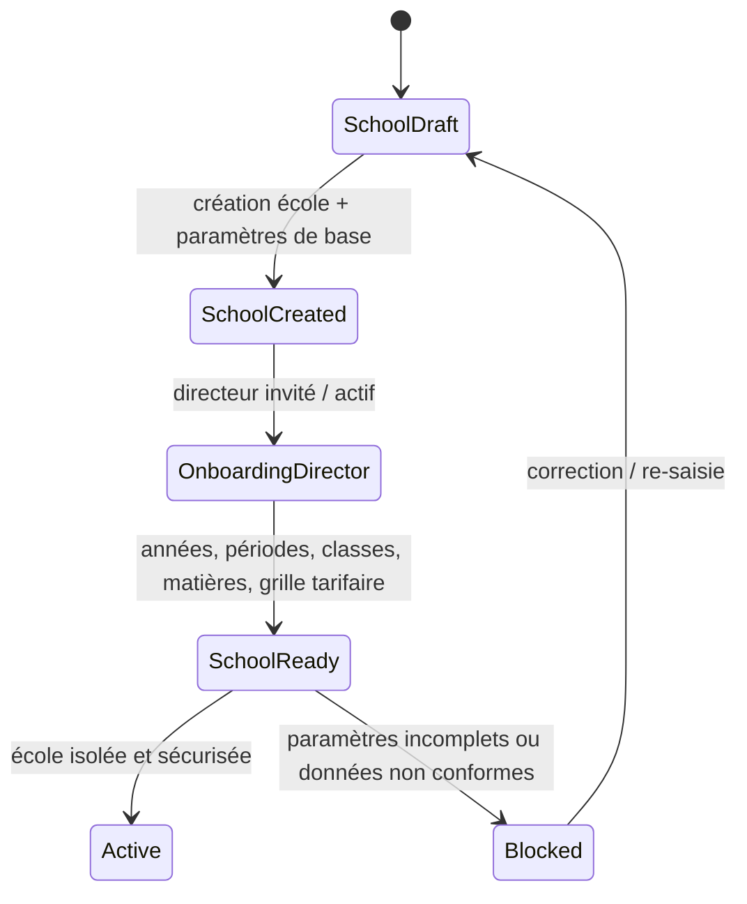

Garde-fous du code actuel :
- l’école est traitée comme un tenant isolé (`school_id` sur les modèles métier) ;
- les demandes d’invitation et les accès aux ressources sont restreints à l’école de contexte ;
- les politiques de rôle et d’intervention contrôlent les permissions à partir du contexte actif.

Effets de bord :
- journal d’audit des interventions et des créations d’utilisateurs ;
- configuration de l’école et de l’année scolaire ;
- initialisation des ressources académiques et financières.

Cas d’échec à couvrir :
- école créée sans directeur valide ;
- année scolaire absente lors de la configuration ;
- classe ou matière manquante ;
- directeur configuré sur mauvais contexte d’école.

Preuve existante :
- `app/Filament/Pages/SchoolOnboarding.php`
- `tests/Feature/StaffInvitationTest.php`
- `tests/Feature/RegistrationApprovalTest.php`

---

## W2 — Demande d’accès / création d’utilisateurs

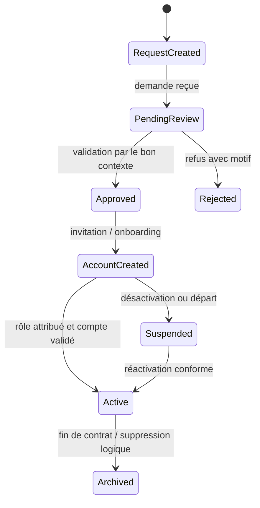

Garde-fins :
- l’approbation est refusée si le contexte de l’école n’est pas actif ;
- les invitations ne peuvent pas déplacer un compte entre écoles ;
- l’édition de rôle et l’activation sont auditées.

Effets de bord :
- création de compte liée à `school_id` ;
- logs de validation, d’invitation et d’acceptation ;
- invalidation de session si le compte est désactivé.

Cas d’échec :
- demande d’une école différente du contexte d’intervention ;
- rôle interdit ou non autorisé ;
- compte déjà normalisé en doublon pour un numéro de téléphone.

Preuve existante :
- `app/Services/StaffInvitationService.php`
- `app/Services/RegistrationApprovalService.php`
- `tests/Feature/RegistrationApprovalTest.php`
- `tests/Feature/StaffInvitationTest.php`
- `app/Http/Middleware/EnsureActiveUser.php`

---

## W3 — Année scolaire et périodes

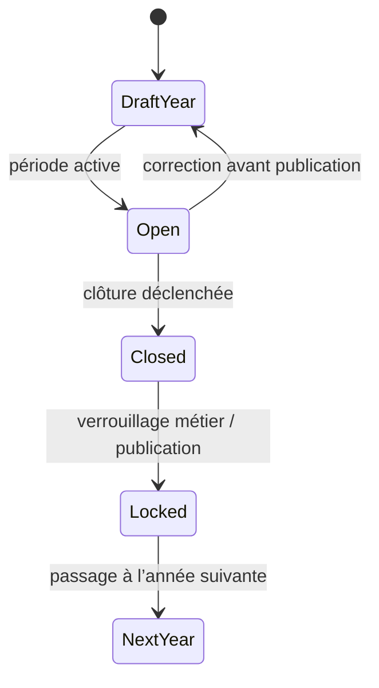

Garde-fins :
- unicité de l’année par école ;
- verrouillage de période côté métier ;
- opération sur les classes / matières et inscriptions alignées sur l’année active.

Effets de bord :
- recalcul des affectations ;
- impact sur les évaluations et les bulletins ;
- limite de mutations sur les périodes fermées.

Cas d’échec :
- année dupliquée par école ;
- période fermée modifiée ;
- élève rattaché à une année incohérente.

Preuve existante :
- `database/migrations/2026_09_08_000002_create_academic_years_table.php`
- `app/Models/AcademicYear.php`
- `tests/Feature/AcademicYearTest.php`

---

## W4 — Inscription / réinscription / transfert / départ d’un élève

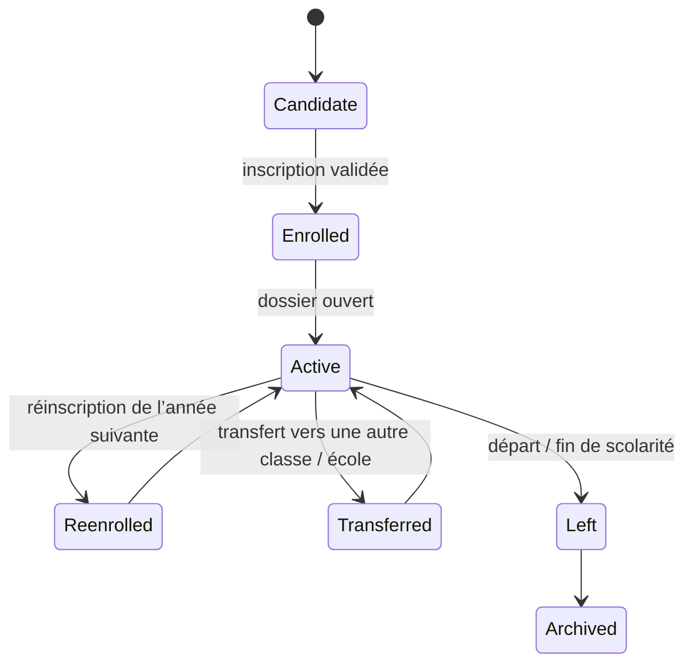

Garde-fins :
- matricule unique par école ;
- facture générée selon la grille tarifaire ;
- responsables avec contact valide ;
- école de rattachement incontestable.

Effets de bord :
- génération des données de finance et du dossier élève ;
- calcul des paiments liés à la structure de frais ;
- historique des changements de classe et de statut.

Cas d’échec :
- doublon de matricule ;
- absence de responsable valide pour les notifications ;
- réinscription sans clôture des dossiers actifs.

Preuve existante :
- `app/Models/Student.php`
- `app/Models/Enrollment.php`
- `app/Models/Guardian.php`
- tests de finance / dossier / présence / sécurité liés à ces modèles

---

## W5 — Présence

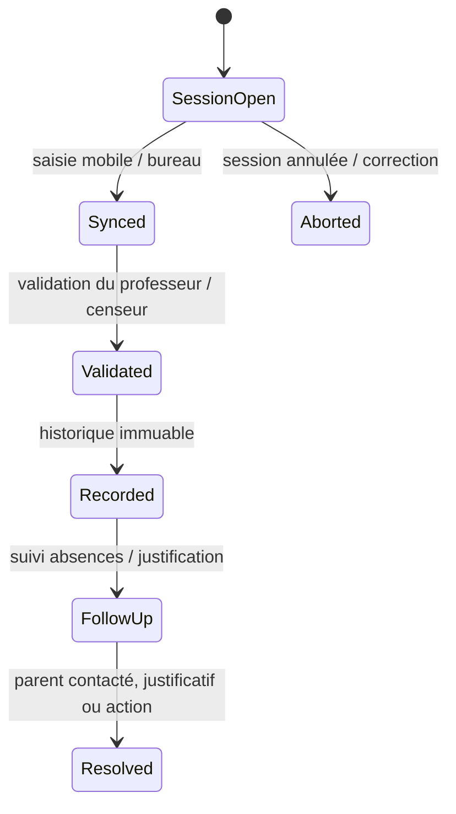

Garde-fins :
- idempotence via `client_operation_id` et contrôle de la synchronisation ;
- accès limité à la classe / année / école du professeur ;
- notification déclenchée seulement après validation de session.

Effets de bord :
- queue de notifications ;
- enregistrement des absences et des suivis ;
- génération de métriques académiques et de rappels.

Cas d’échec :
- double envoi de la même présence ;
- classe étrangère à l’enseignant ;
- notification envoyée avant validation ou en dehors de la période ;
- parent `opt-out` pour la notification.

Preuve existante :
- `tests/Feature/AttendanceWorkflowTest.php`
- `app/Services/AttendanceService.php`
- `app/Services/NotificationService.php`
- `app/Models/AbsenceFollowUp.php`

---

## W6 — Notes → bulletins

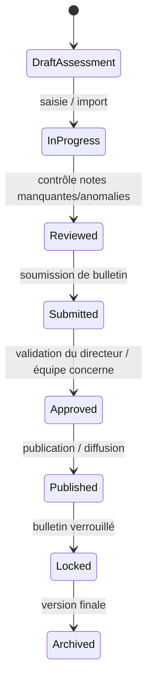

Garde-fins :
- contrôle de périmètre enseignant / classe / année ;
- publication verrouillée : aucun recalcul d’un bulletin publié ;
- notes et mentions alignées sur le paramétrage de l’école / cycle / série / année.

Effets de bord :
- calcul pondéré ;
- mention et rang ;
- remontée des absences et de la conduite.

Cas d’échec :
- note saisie hors périmètre de l’enseignant ;
- bulletin publié puis recalculé ;
- mention calculée avec configuration non conforme.

Preuve existante :
- `tests/Feature/AcademicGradingTest.php`
- `tests/Feature/ReportCardWorkflowTest.php`
- `app/Models/ReportCard.php`
- `app/Models/ReportCardTemplate.php`
- `app/Models/EvaluationRuleSet.php`

À confirmer / à compléter :
- verrouillage métier et versionnage complet des barèmes, ainsi que les cas d’export PDF et de publication finale.

---

## W7 — Facturation → encaissement espèces → reçu

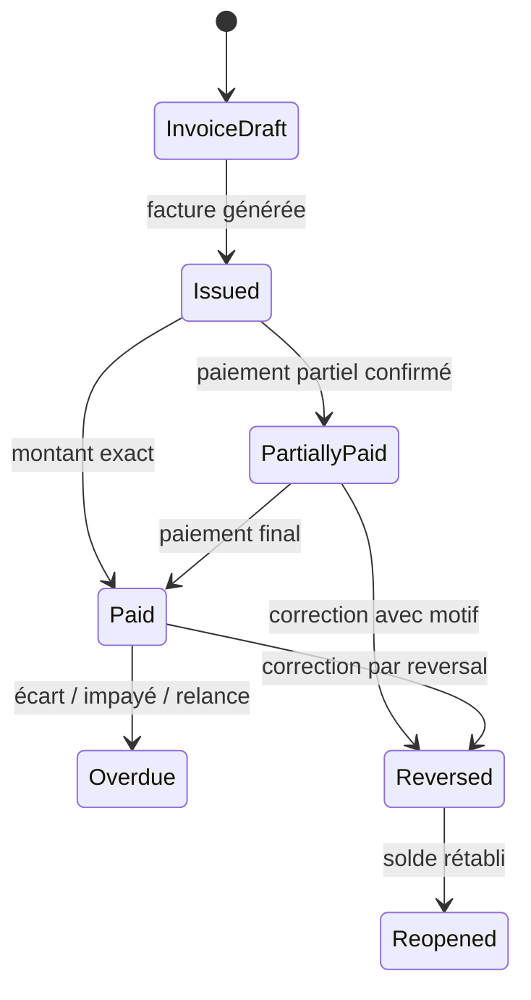

Garde-fins :
- paiement immuable ; aucune suppression directe ;
- correction seulement par reversal directeur ;
- reçu numéroté séquentiellement sans trou ;
- solde recalculé à partir du montant confirmé.

Effets de bord :
- mise à jour du solde ;
- génération de reçu / notification ;
- historique d’audit et trace de l’opération.

Cas d’échec :
- paiement en double via un `idempotency_key` ;
- comptable tentant un reverse sans droit ;
- paiement en attente non comptabilisé dans le solde ;
- surpaiement sans allocation claire.

Preuve existante :
- `tests/Feature/FinanceWorkflowTest.php`
- `app/Services/Payments/PaymentService.php`
- `app/Services/Payments/InvoiceService.php`
- `app/Models/PaymentReversal.php`

---

## W8 — Caisse : dépenses et journal quotidien

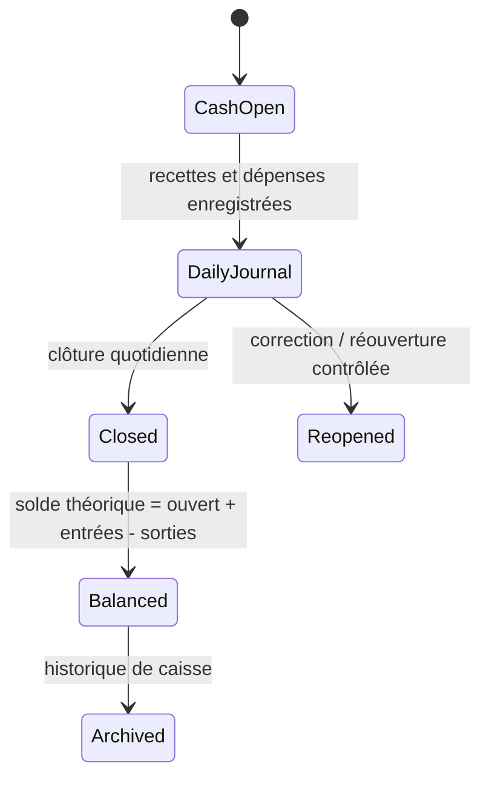

Garde-fins :
- bons de sortie numérotés ;
- catégorie par école configurable ;
- impossible de modifier en direct un document de caisse validé.

Effets de bord :
- mise à jour du solde ;
- journal de trésorerie ;
- rapprochement comptable.

Cas d’échec :
- clôture sans solde cohérent ;
- catégorie manquante ;
- opération de dépense hors contexte d’école.

Preuve existante :
- `app/Models/Expense.php`
- `app/Models/CashClosure.php`
- `app/Models/CashOpeningBalance.php`
- `tests/Feature/ExpenseWorkflowTest.php`

---

## W9 — Recouvrement

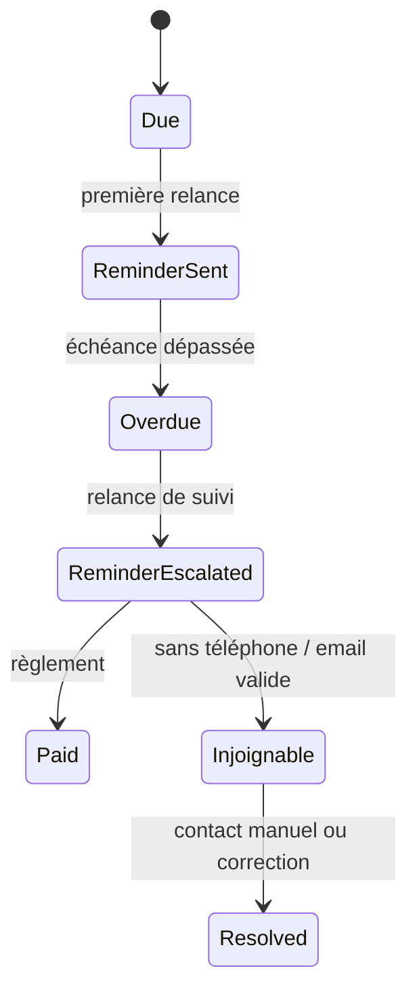

Garde-fins :
- relance uniquement pour les échéances non soldées ;
- idempotence sur l’échéance ;
- liste d’injoignables distincte des relances actives.

Effets de bord :
- `CollectionReminder` ;
- notifications ;
- suivi comptable des impayés.

Cas d’échec :
- double relance pour la même échéance ;
- relance sans contact de la famille ;
- données de contact invalides ou non conformes.

Preuve existante :
- `app/Models/CollectionReminder.php`
- `tests/Feature/FinanceWorkflowTest.php` (collection reminder)
- `tests/Feature/DueReminderTest.php`

---

## W10 — Documents administratifs

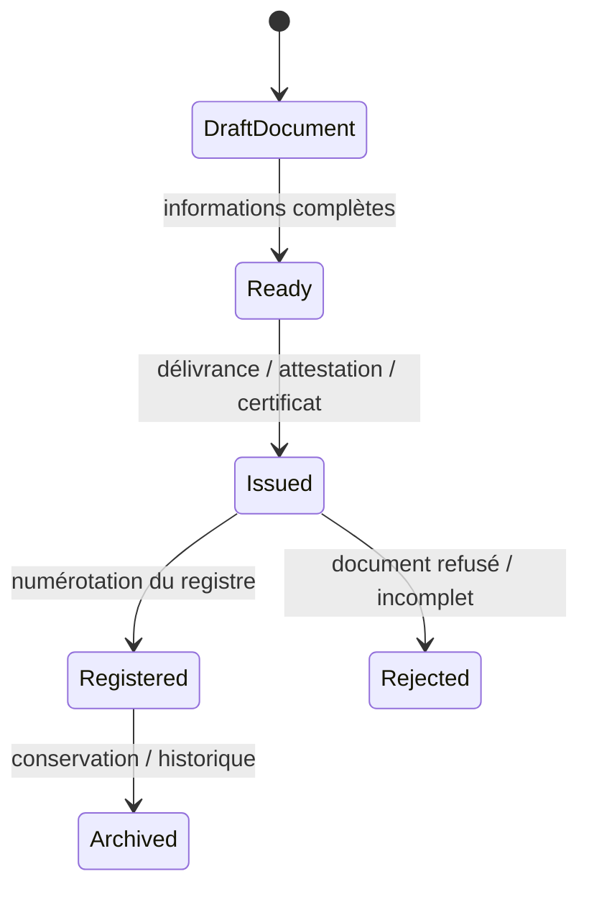

Garde-fins :
- registre numéroté ;
- attestation générée à partir d’un moteur de document cohérent avec les bulletins ;
- accès limité au rôle autorisé.

Effets de bord :
- enregistrements de délivrance ;
- liens ou PDF générés ;
- historique de documents pour l’école.

Cas d’échec :
- document délivré hors contexte scolaire ;
- numérotation sans séquence ;
- paramètres de certificat non conformes.

Preuve existante :
- `app/Models/Certificate.php`
- `database/migrations/2026_09_10_000009_create_certificates_table.php`
- `tests/Feature/CertificateWorkflowTest.php`

---

## W11 — Notifications

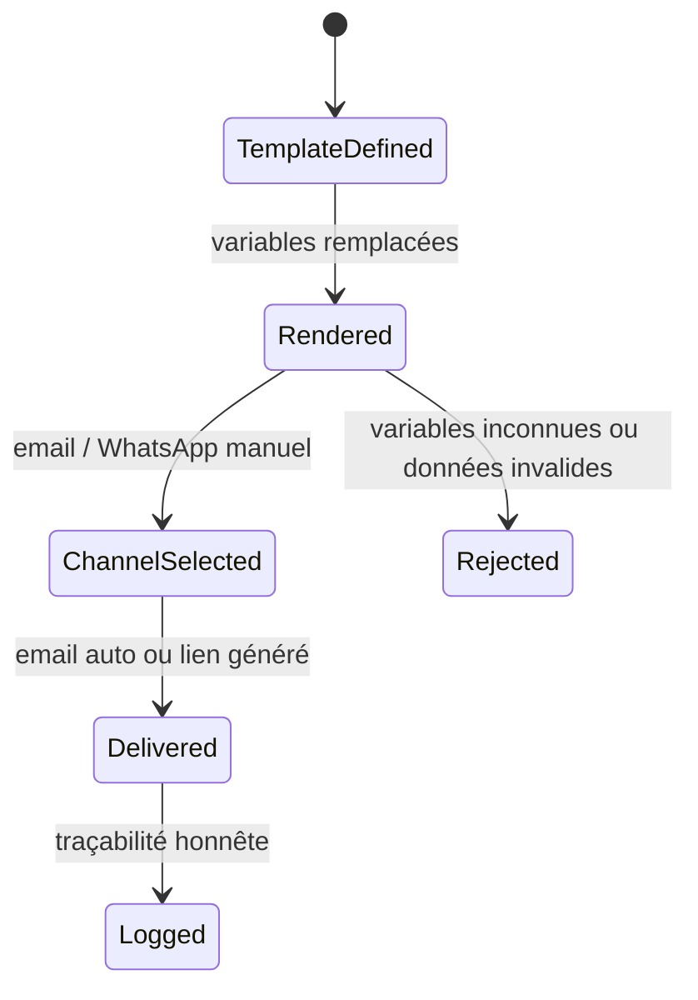

Garde-fins :
- le rendu de template est séparé du canal de diffusion ;
- le numéro WhatsApp est normalisé, validé et converti en `wa.me` uniquement si la donnée est exploitable ;
- les e-mails ne doivent pas exposer de secrets ni de configuration entre écoles.

Effets de bord :
- queue de notification ;
- journal de diffusion ;
- suivi de relance ou d’alertes.

Cas d’échec :
- template avec variable non remplacée ;
- numéro WhatsApp invalide ;
- email impossible à envoyer sans bloquer la validation métier.

Preuve existante :
- `app/Models/MessageTemplate.php`
- `app/Models/NotificationLog.php`
- `app/Models/NotificationQueue.php`
- `tests/Feature/NotificationProviderRetryTest.php`
- `tests/Feature/NotificationScopeTest.php`

Important :
- le cahier des charges impose un canal “Click-to-Chat” manuel, non automatique, et un canal email serveur. Les logs doivent enregistrer la génération du lien sans affirmer une livraison WhatsApp.

---

## W12 — Super admin

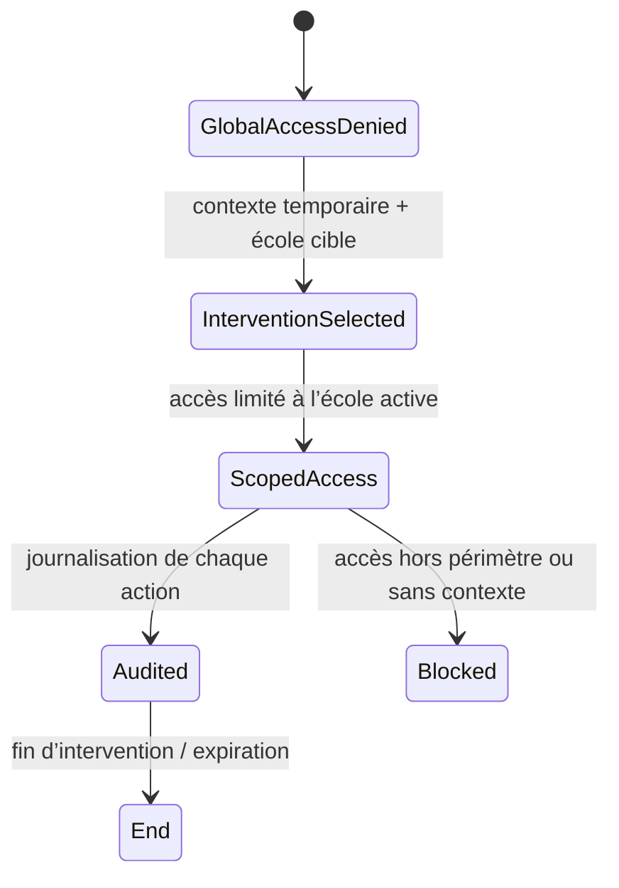

Garde-fins :
- accès global interdit hors contexte d’intervention ;
- données d’école accessibles uniquement en intervention active ;
- actions et routes auditées.

Effets de bord :
- journal d’audit ;
- limitation des pages visibles ;
- restriction des permissions par école.

Cas d’échec :
- super admin sans intervention ;
- intervention active mais école cible non cohérente ;
- export ou accès direct à une autre école en URL.

Preuve existante :
- `tests/Feature/SuperAdminInterventionAccessTest.php`
- `tests/Feature/SuperAdminBootstrapTest.php`
- `tests/Feature/SuperAdminDashboardTest.php`
- `app/Services/StaffInvitationService.php`
- `app/Services/RegistrationApprovalService.php`

---

## Points de vigilance d’implémentation

| Sujet | Niveau | Observation |
|---|---|---|
| Paramétrage réglementaire | À confirmer | Coefficients, mentions, seuils et documents professionnels ne doivent pas être codés en dur sans validation métier. |
| SMTP par école | À confirmer | L’architecture permet le multi-tenant, mais le choix de compte central vs SMTP par école doit être validé avant production. |
| WhatsApp automatisé | À confirmer | Le design actuel est manuel; aucun envoi automatique n’est invoqué ni promis. |
| É2E complet W1–W12 | Partiel | Le projet a de nombreux tests unitaires/feature, mais la couverture navigateur complète reste à finaliser pour les parcours de production. |
| UX mobile | À confirmer | À revoir dans la phase UX/UI, avec 320/390/768/1280 px et parcours de rôle. |

## Conclusion de phase

La phase 3 est désormais documentée sur la base du code réel, et la preuve de la cohérence métier est concentrée dans les services et tests déjà présents. La suite logique est la validation E2E complète et la finition des workflows non encore entièrement bouclés, puis le passage à la phase UX/UI et à la checklist de production.
