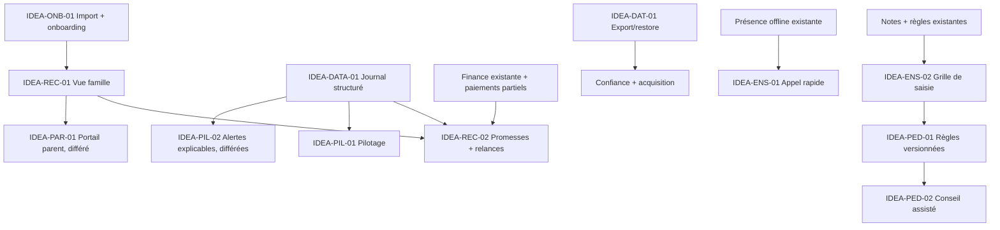

# 04 — Priorisation et feuille de route

## Résumé en 10 lignes

1. La pondération favorise l’impact mesurable, la fréquence, la différenciation, l’adoption et la faisabilité solo.
2. Le risque légal/données/technique et la dépendance payante sont soustraits au score.
3. IDEA-ONB-01 (import + inscription cohérente) est le premier pari d’acquisition proposé.
4. Le recouvrement vient ensuite, au-dessus d’une base famille/promesse vérifiable.
5. Les opérations de caisse et le pilotage doivent étendre le code déjà présent, pas le dupliquer.
6. Les outils enseignants gagnent à réutiliser la présence et les notes actuelles, sans promettre un offline généralisé.
7. Journal, export et restauration sont des fondations de confiance, même s’ils sont moins visibles en démo.
8. Le portail parent est reporté jusqu’à l’adoption interne et à la validation des droits d’accès.
9. La capacité de développement hebdomadaire est inconnue ; les séquences ci-dessous sont en jours d’effort, pas des engagements calendaires.
10. Tout pari doit passer par le kit `06-validation-terrain.md` avant activation terrain; pour IDEA-ONB-01, l’implémentation locale est faite et le gate restant est la validation pilote.

## Grille de score

Chaque critère vaut de 1 à 5. Pour les coûts/risques, 1 = faible et 5 = élevé.

**Score = 3I + 2F + 2D + 2A + E + 2S − 2R − P**

- I : impact métier mesurable ; F : fréquence ; D : différenciation/défendabilité ; A : acquisition/adoption/rétention ; E : réutilisation de l’existant ; S : faisabilité solo (5 = faisable à faible effort) ; R : risque légal/données/technique ; P : dépendance à un tiers payant.
- Résultat maximum théorique : 60 ; minimum : −3. Score indicatif pour ordonner le terrain, non vérité objective.
- Fourchettes d’effort incluent cadrage, tests et itération solo, hors attente d’avis juridique et intégration commerciale.

## Classement de toutes les idées

Abréviations : `I/F/D/A/E/S/R/P`. Les scores ont été calculés selon la formule ci-dessus.

| Rang | ID | I/F/D/A/E/S/R/P | Score | Effort solo estimé | Dépendance / décision |
|---:|---|---|---:|---:|---|
| 1 | IDEA-ONB-01 | 5/5/4/5/4/4/2/1 | 50 | 8–14 j | Fondations ; premiers imports test → inscription cohérente. |
| 2 | IDEA-REC-02 | 5/5/4/4/4/4/2/1 | 48 | 6–10 j | Après vue soldes; rappel interne avant canal externe. |
| 3 | IDEA-PIL-01 | 4/5/3/5/4/4/2/1 | 45 | 5–9 j | Utilise données existantes ; dépend d’indicateurs cohérents. |
| 4 | IDEA-REC-04 | 4/5/3/4/5/4/2/1 | 44 | 3–6 j | Étendre allocation existante ; paiements partiels avant relance. |
| 5 | IDEA-DATA-01 | 4/4/5/4/4/3/2/1 | 43 | 7–12 j | Fondation avant alertes et mesures d’usage. |
| 6 | IDEA-REC-01 | 5/4/4/4/3/3/3/1 | 41 | 8–14 j | Fondation famille/fratrie ; valider les règles de fusion. |
| 7 | IDEA-ONB-02 | 3/4/3/4/4/4/1/1 | 40 | 3–6 j | Après import pilote ; checklist ciblée. |
| 8 | IDEA-REC-03 | 4/4/3/4/4/4/2/2 | 40 | 5–8 j | Après modèles et état famille ; WhatsApp manuel. |
| 9 | IDEA-ENS-01 | 4/5/3/4/4/3/3/1 | 39 | 6–12 j | Tester/optimiser le flux hors-ligne existant. |
| 10 | IDEA-ENS-02 | 4/4/3/4/4/3/2/1 | 39 | 7–12 j | Après instrumentation de la saisie actuelle. |
| 11 | IDEA-DAT-01 | 4/3/5/4/3/3/3/1 | 38 | 6–10 j | Compléter audit avec export/restauration vérifiés. |
| 12 | IDEA-ROB-01 | 4/4/5/4/4/2/4/1 | 37 | 6–12 j | Fondation ; étendre présence et tester les conflits. |
| 13 | IDEA-OPS-01 | 3/3/2/3/5/4/1/1 | 35 | 2–5 j | Conflits déjà détectés ; vérifier l’ergonomie. |
| 14 | IDEA-PED-04 | 4/3/4/3/4/3/3/1 | 35 | 6–10 j | Réutiliser le versionnement de bulletin. |
| 15 | IDEA-BIZ-01 | 3/2/2/4/3/4/1/1 | 33 | 2–5 j | Test de volonté de payer, pas code métier. |
| 16 | IDEA-PED-01 | 5/3/4/3/3/2/4/1 | 33 | 12–20 j | Dépend de la validation des règles par les écoles. |
| 17 | IDEA-PIL-03 | 4/3/4/3/3/3/4/1 | 32 | 8–14 j | Après journal structuré et seuils humains. |
| 18 | IDEA-SUP-01 | 2/3/2/3/3/5/1/1 | 32 | 1–3 j | Lien support sans données d’élèves. |
| 19 | IDEA-PED-02 | 4/2/4/3/3/2/3/1 | 30 | 10–16 j | Après règles validées et données propres. |
| 20 | IDEA-PIL-02 | 4/3/4/3/3/2/4/1 | 30 | 12–20 j | Après journal ; explicable, jamais décisionnaire. |
| 21 | IDEA-REC-06 | 3/2/3/2/3/4/2/1 | 29 | 4–8 j | Préparer sans intégration mobile money. |
| 22 | IDEA-OPS-03 | 3/3/2/2/4/3/2/1 | 28 | 6–10 j | Étendre dépenses et approbations existantes. |
| 23 | IDEA-RET-01 | 2/3/3/3/3/4/3/1 | 28 | 4–8 j | Mesures agrégées, sans contenu nominatif. |
| 24 | IDEA-PAR-01 | 4/4/2/3/2/2/5/1 | 25 | 18–30 j | Reporté ; sécurité parent/mineurs et support. |
| 25 | IDEA-OPS-06 | 4/2/4/2/2/1/4/1 | 23 | 20–35 j | Seulement sur demande multi-site réelle. |
| 26 | IDEA-INT-01 | 2/2/3/2/2/3/2/2 | 22 | 4–8 j | Ports internes minimaux avant API publique. |
| 27 | IDEA-OPS-05 | 3/2/2/3/2/2/3/1 | 22 | 10–16 j | Après import ; risque de données publiques de mineurs. |
| 28 | IDEA-PIL-04 | 3/2/3/2/3/2/4/1 | 21 | 10–18 j | Reporter jusqu’à historiques fiables. |
| 29 | IDEA-OPS-02 | 3/2/2/2/2/2/3/1 | 20 | 10–18 j | Dépend d’une présence enseignants fiable. |
| 30 | IDEA-PED-03 | 3/2/2/2/2/3/4/1 | 20 | 5–9 j | Attendre une source officielle d’export. |
| 31 | IDEA-ENS-03 | 2/3/1/2/2/2/2/1 | 19 | 10–18 j | Après adoption des flux essentiels. |
| 32 | IDEA-ENS-04 | 2/3/2/2/3/3/4/2 | 19 | 5–9 j | Suggestions déterministes ; IA reportée. |
| 33 | IDEA-PAR-02 | 3/2/3/2/2/2/5/1 | 18 | 12–20 j | Dépend de la famille et d’une revue juridique. |
| 34 | IDEA-REC-05 | 2/2/3/2/2/2/4/1 | 17 | 8–14 j | Reporter jusqu’à analyse de menace et preuve d’abus. |
| 35 | IDEA-VIE-01 | 2/2/2/2/2/3/4/1 | 17 | 8–14 j | Incidents/sorties ; cadrage juridique préalable. |
| 36 | IDEA-OPS-04 | 2/3/1/1/1/2/2/1 | 16 | 12–22 j | Besoin de stock à confirmer dans ≥3 écoles. |
| 37 | IDEA-DATA-02 | 2/1/3/1/1/1/5/1 | 8 | 10–20 j | Veille ; consentement et agrégation à valider. |
| 38 | IDEA-IA-01 | 2/2/1/1/1/1/5/4 | 3 | 15–30 j | Ne pas faire MVP ; tiers et mineurs. |
| 39 | IDEA-ENS-05 | 2/1/1/1/1/1/5/4 | 1 | 20–40 j | Rejeter OCR jusqu’à preuve ≥99,5 % hors-ligne. |
| 40 | IDEA-VIE-03 | 1/1/1/1/1/1/5/1 | 1 | 15–30 j | Ne pas faire sans cadrage juridique explicite. |

## Dépendances produit

## Catégories d’investissement

### Fondations

1. **IDEA-ONB-01**, 8–14 j : import guidé, aperçu et cohérence inscription/année/classe.
2. **IDEA-DATA-01**, 7–12 j : événements critiques, acteurs, valeurs utiles et accès auditables.
3. **IDEA-REC-01**, 8–14 j : relation famille/tuteurs/enfants sans partage d’identité par numéro.
4. **IDEA-DAT-01**, 6–10 j : export complet et restauration testée.
5. **IDEA-ROB-01**, 6–12 j pour présence (étendre l’existant), puis chiffrer notes séparément.

### Gains rapides (≤ 1 semaine d’effort, après validation)

- IDEA-ONB-02 checklist guidée (3–6 j), IDEA-REC-04 paiements partiels (3–6 j), IDEA-OPS-01 correction UX de conflits (2–5 j), IDEA-SUP-01 support contextuel sans donnée élève (1–3 j).
- IDEA-REC-03 modèles Click-to-Chat/email (5–8 j) uniquement après suivi famille et en étiquetant « lien généré/ouvert », pas « envoyé ».

### Paris différenciants (1 à 2 mois d’effort)

- IDEA-REC-02 promesses datées + recouvrement gradué (6–10 j hors dépendances).
- IDEA-PIL-01 tableau de direction avec indicateurs audités (5–9 j).
- IDEA-ENS-01 appel ultra-rapide et IDEA-ENS-02 saisie de notes efficace (6–12 j puis 7–12 j).
- IDEA-PED-01 règles versionnées/cas d’année clôturée et IDEA-PED-02 conseil assisté seulement après observation.

### Veille / plus tard / ne pas faire

- Portail parent, multi-campus, examens officiels, comparaison inter-écoles : après demande pilote, contrôle des accès et validation de conformité.
- IA/OCR, données santé, décision automatique de passage/sanction : ne pas faire dans MVP ; risque supérieur au gain démontré.
- Mobile money automatisé et SMS/WhatsApp API : pas avant seuil de volume et cas d’usage payant confirmé.
- Stocks/cantine/bibliothèque/paie : ne pas empiler des modules non prioritaires avant adoption des parcours principaux.

## Top 5 des paris recommandés

| Ordre | Pari / thèse | KPI pilote | Risque majeur | À valider avant code |
|---:|---|---|---|---|
| 1 | **IDEA-ONB-01 — Import sans technicien** : l’activation autonome rend l’offre vendable à des écoles moyennes/grandes et évite un service de migration coûteux. | Import de 2 000 élèves ≤1 jour ; ≥98 % lignes valides ; aucune mauvaise classe/année. | Fichiers réels incohérents et données doublons. | 3 fichiers anonymisés (format, accents, doublons), secrétaire exécutant seule. |
| 2 | **IDEA-REC-01 + 02 — famille et promesse** : la relation débiteur devient actionnable et différenciante sans API payante. | Familles relancées/heure ×2 ; promesses échues sans suivi −50 % à 6 semaines. | Mauvaise fusion tuteurs/fratrie ou relance indue. | Qui est juridiquement débiteur ? Quelle permission et politique sur remise/échelonnement ? |
| 3 | **IDEA-PIL-01 + IDEA-OPS-03 — pilotage et caisse** : rendre visible le contrôle financier pour le propriétaire/fondateur. | État hebdo <5 min ; clôture ≤10 min ; 100 % écarts avec statut. | Données de caisse en retard ou indicateur trompeur. | Voir 4 semaines de clôtures et comparer chiffres à cahier source. |
| 4 | **IDEA-ENS-01 — appel fiable en coupure** : expérience quotidienne utile qui fait adopter les données de présence nécessaires à d’autres workflows. | Appel médian ≤30 s ; 0 perte sur tests de coupure ; 95 % validations le jour même. | L’app actuelle peut déjà suffire, ou appareil/réseau bloque. | Observer 10 appels sur Android bas de gamme, classe réelle et réseau instable. |
| 5 | **IDEA-PED-01 + 02 — règles locales explicables** : l’historique de règles/versions et la préparation du conseil créent de la confiance durable. | Corrections après publication −80 % ; préparation conseil −50 % temps. | Variantes de règles non documentées ou format officiel supposé. | Collecter règlements anonymisés de 3 écoles ; valider les règles par directeur/enseignant. |

### Vérification des 5 filtres d’innovation

| Pari | Qui l’utilise et quand ? | Changement mesurable | Terrain togolais | Faisabilité solo / tiers | Défendabilité |
|---|---|---|---|---|---|
| Import (IDEA-ONB-01) | Secrétaire à chaque rentrée/réinscription. | 2 000 dossiers ≤1 jour ; ≥98 % lignes valides. | CSV, français, aperçu lisible sur téléphone/tablette et sans data upload vers un service tiers ; fichier volumineux mieux traité sur connexion stable. | 8–14 j, aucun API payant. | Mapping et profils de données d’écoles + rapport d’import exact, sans fusion opaque. |
| Famille/promesses (IDEA-REC-01/02) | Comptable chaque jour d’encaissement/relance. | Promesses sans suivi −50 % ; relances/heure ×2. | Espèces en premier ; téléphone partagé traité sans fusion ni exposition du montant par défaut. | 14–24 j ; rappel interne, Click-to-Chat manuel. | Historique validé des relations et promesses, règles locales de paiement et confiance. |
| Pilotage/caisse (IDEA-PIL-01) | Directeur chaque matin et à la clôture. | État <5 min ; clôture ≤10 min ; écarts suivis à 100 %. | Vue légère, FCFA, horodatage clair, fonctionne en lecture du dernier état si coupure. | 5–9 j en réutilisant finance existante, aucun service payant. | Calculs rattachés aux transactions auditées, cohérence de caisse accumulée. |
| Appel fiable (IDEA-ENS-01) | Enseignant au premier cours, chaque jour. | Appel médian ≤30 s ; zéro perte sur coupure testée. | Android modeste, gros boutons, français, sync après réseau, aucun paiement/OTP. | 6–12 j en optimisant sync existante. | Confiance par reprise et flux simple intégrés au fonctionnement réel des classes. |
| Règles/conseil (IDEA-PED-01/02) | Censeur et enseignants en fin de période/année. | Corrections −80 % ; conseil −50 % temps. | Règles configurées à l’école, imprimables et compréhensibles ; pas de format officiel présumé. | 22–36 j ; aucune API payante, décision humaine. | Versions/résultats tracés par école, niveau et année ; apprentissage métier accumulé sans mutualiser les données élèves. |

## Ordre d’exécution en jours-personne

| Séquence | Contenu | Effort total indicatif |
|---|---|---:|
| 0. Observation | Entretiens, parcours chronométrés, baseline sur pilote | 3–6 j |
| 1. Activation | Import/aperçu, erreurs par ligne, inscriptions et checklist | 8–14 j |
| 2. Confiance | Journal utile, tests d’isolation, export + restore | 13–22 j |
| 3. Recouvrement | Famille, promesse, liste d’action, modèles et journal d’action | 14–24 j |
| 4. Pilotage | Clôture et synthèse direction horodatée | 7–12 j |
| 5. Productivité pédagogique | Appel rapide, grille notes, règles versionnées / conseil | 25–44 j |

Les estimations sont en jours d’effort solo et comprennent tests ciblés, mais ne comprennent ni revue juridique, ni délais d’entretien, ni support de déploiement, ni intégration avec des systèmes externes. Le calendrier 30/90/180 jours ne peut pas être promis tant que la capacité hebdomadaire est inconnue ; ces séquences peuvent être reportées telles quelles dans un calendrier dès que celle-ci est choisie.

### Repères 30 / 90 / 180 jours — enveloppes conditionnelles, non dates promises

| Horizon demandé | Résultat à viser si la capacité le permet | Effort cumulé indicatif | Décision de passage |
|---|---|---:|---|
| 30 jours | Baseline terrain, import guidé et première école activée | 11–20 j | Poursuivre uniquement si import pilote et première valeur réussis. |
| 90 jours | Fondations de confiance + famille/promesses + premier pilotage direction | 45–78 j | Poursuivre si promesses suivies et clôture réconciliée, sans écart d’accès. |
| 180 jours | Flux enseignant et règles versionnées/conseil après validation des 3 premières étapes | 70–122 j | Portail parent toujours conditionné à la validation sécurité/usage. |

Ces enveloppes supposent que le travail peut être séquencé sans attente longue des écoles ni incident de production. Comme la capacité hebdomadaire déclarée est inconnue, elles ne sont **pas** une promesse de livrer ces résultats à ces échéances. Conversion une fois la capacité choisie : `semaines nécessaires = jours d’effort ÷ jours de développement disponibles par semaine`; tenir compte des semaines commerciales et du support.

## Chemin vers les canaux payants

Pas d’API payante requise. Les seuils sont des **hypothèses à tester**, pas des tarifs fournisseur.

| Étape | Déclencheur d’étude | Action |
|---|---|---|
| WhatsApp Click-to-Chat + email existant | Plus de 300 liens mensuels par école **et** >4 h/mois de travail manuel, 2 mois consécutifs ; ou moins de 50 % des relances prioritaires traitées à temps. | Mesurer liens générés/ouverts (pas messages livrés), action humaine déclarée, coût réel et taux de conversion en paiement. |
| SMS ou API WhatsApp payante | Le canal est opt-in et un test d’un mois montre au moins 2× la valeur FCFA récupérée par FCFA de coût total, sans compter un « taux de livraison » non confirmé. | Pilote fermé, plafonds école, désinscription, journal d’envoi, séparation provider et métier. |
| Mobile money agrégé | ≥100 transactions/mois en attente de rapprochement **ou** >2 h/semaine de rapprochement manuel ; coût de l’intégration supportable par l’école. | Comparer coût par transaction/abonnement, litiges et rapprochement; exiger webhook idempotent. |

**Coût cible hypothétique** : ≤1 % des frais mensuels moyens recouvrés par élève (plafond, non tarif observé), ou coût variable payé explicitement par l’école. [À CONFIRMER] Prix réel, volumes, coût fournisseur et capacité de répercuter ce coût sont inconnus. Évaluer `FCFA/messages ÷ élèves actifs` et `FCFA/encaissement confirmé` sur devis datés.

**Taux d’ouverture :** Click-to-Chat ne révèle ni ouverture du message ni livraison ; mesurer seulement le lien généré/ouvert et le résultat déclaré par le personnel. Pour l’email, ne pas installer de pixel de suivi sur les communications concernant des mineurs sans validation juridique et consentement/information appropriés. À défaut de mesure licite et fiable, décider sur les réponses obtenues, promesses honorées et paiements rapprochés, pas sur un taux d’ouverture.

## État IDEA-ONB-01

**État au 20 octobre 2026 : MVP local implémenté; validation pilote en attente.** Le parcours CSV, son staging, la revue, la reprise, l’ACL et la purge sont couverts par des tests synthétiques. La mesure d’analyse/simulation de 2 000 lignes ne valide pas le KPI de 2 000 inscriptions en une journée.

Prochain gate : obtenir un fichier anonymisé autorisé et valider le mapping, les règles métier, la réconciliation et le parcours chronométré avec l’école pilote; confirmer la conservation avec un juriste/IPDCP et tester le stockage/purge de production. Ne pas importer de données réelles ni démarrer le pari suivant avant cette revue. Détails et limites : `docs/dev/onb-01-rapport-mesure.md` et `docs/dev/onb-01-decisions.md`.
