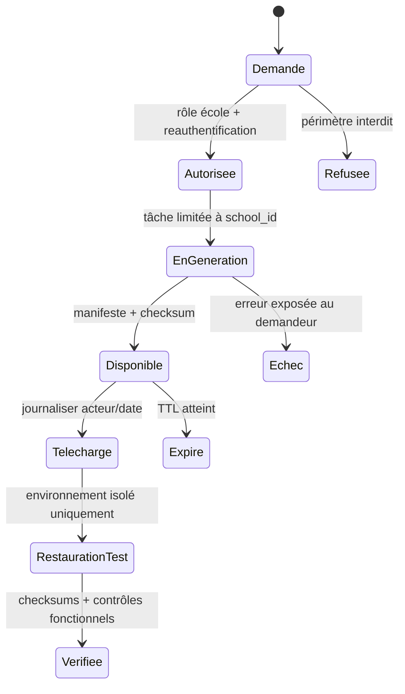

# Fiche IDEA-DAT-01 — Portabilité, audit lisible et restauration

## Résumé en 10 lignes

1. Un audit avant/après est présent ; un export complet et restaurable n’est pas prouvé.
2. Le directeur demande un export école et consulte les événements sensibles.
3. Le lot d’export comprend données structurées et manifeste, sans accès à une autre école.
4. Les sauvegardes d’infrastructure restent gérées par hébergeur ; l’application n’affirme pas qu’elle les réalise.
5. Toute opération d’export est tracée et limitée dans le temps.
6. La restauration est testée en environnement isolé avant toute promesse de portabilité.
7. Le journal montre qui/quoi/quand/avant-après pour les événements critiques.
8. Les données de mineurs sont minimisées et protégées dans les fichiers générés.
9. Le module ne collecte pas le contenu d’un dossier complet pour des statistiques d’usage.
10. KPI : export et vérification <1 h ; restauration d’échantillon 100 % réussie.

## 1. Problème, persona, KPI

Directeur qui veut confiance et plan de sortie; support qui enquête sur paiement/correction. L’audit des modèles est prouvé (`Auditable.php`, migration `000011`); backup à Render figure comme responsabilité du fournisseur dans README, pas de l’application. Avant : mesurer délai à produire un dossier complet, événements impossibles à reconstituer, restauration testée. Après : export documenté en <1 h et test de réimport restauré sans fuite.

## 2. Périmètre

- **MVP** : journal lisible pour événements critiques ; export CSV/JSON par catégorie et date avec manifeste/version ; export asynchrone si volumineux et lien expirant ; restauration en staging/test.
- **V2** : export complet automatisé à la demande, contrôles de checksum, exercice trimestriel de restore.
- **Hors périmètre** : sauvegarde d’objets par l’app si hébergeur non configuré ; export public via QR ; analytics inter-écoles.

## 3. Workflow

Échec ne donne jamais un export partiel présenté comme complet. Reprise génère un nouveau lot et un nouveau manifeste. Aucune restauration directe en production par bouton.

## 4. Modèle de données

Réutiliser `audit_logs`, `Auditable` et versions de bulletins. Nouvelles tables : `data_export_jobs(id,school_id,requested_by,status,scope_json,manifest_hash,storage_key,expires_at,created_at)` et `export_events(school_id,job_id,actor_id,event_type,created_at)`. Index `(school_id,status,created_at)`, unique token opaque, stockage chiffré et objet non-public. `school_id` obligatoire, scoping avant query et à la création du fichier.

Manifeste contient catégories, compteurs, bornes, version schéma, checksum; exclure `.env`, secrets, sessions, tokens et fichiers temporaires. Audit data sensible minimisée selon besoins.

## 5. ACL

| Action | Directeur | Comptable | Secrétaire | Enseignant | Super admin |
|---|---:|---:|---:|---:|---:|
| Demander export de son école | Oui | Finance limitée | Non | Données de ses classes uniquement en export ciblé | intervention + motif |
| Télécharger | Oui, reauth | Export finance autorisé | Non | Non par défaut | intervention auditée |
| Voir journal | Oui | Finance pertinent | Limité à ses actions | Limité à ses classes | accès justifié |
| Restaurer | Non en production | Non | Non | Non | Opération hors app, procédure séparée |

## 6. UX

Écran export avec périmètre, date, format, estimation taille, expiration; écran journal filtré par type/acteur. Cible ≤4 actions. Mobile autorise consulter le journal et demander export ; télécharger gros fichier propose avertissement données sensibles. Message : « Export incomplet : aucune archive n’est disponible. Le support a reçu un identifiant d’erreur {id}. »; « Lien expiré : générez un nouvel export. » Français clair, date/heure et fuseau.

## 7. Notifications

Email au demandeur lorsque le fichier est disponible ou échec explicite, variables `{school_name}`, `{export_id}`, `{expires_at}`, `{download_url}`, `{error_reference}`. Aucun détail d’élève dans sujet. WhatsApp n’est pas utilisé pour exporter ou transporter un lien sensible. Pas de statut « envoyé » manuel ; l’email queue signale en file/envoi/échec selon backend.

## 8. Cas limites

Export pendant changement de données : snapshot cohérent ou fenêtre de date explicite ; pagination et checksum. École désactivée : appliquer politique de conservation avant export. Année clôturée : inclure historique si sélectionné. Donnée supprimée/rectifiée : suivre règle de rétention validée, conserver preuve d’action sans copie superflue. Même personne dans plusieurs écoles : l’export n’inclut jamais l’autre tenant.

## 9. Conformité

Export peut contenir toutes données élèves, familles, notes et finance. Finalité portabilité, audit et continuité. Chiffrement transit/repos, accès minimal, expiration par défaut **24 h** (proposition à valider), journal de téléchargement. [À CONFIRMER juriste/IPDCP] droit à portabilité/format, durées, sous-traitants, transferts, rétention backups et droits des mineurs.

## 10. Intégrations et tests

Stockage persistant déjà recommandé (`FILESYSTEM_DISK=s3` en production README); ne pas présumer qu’il est configuré. Aucun tiers payant d’export. Tests de contenu/manifeste/checksum, expiration/permissions, fuite inter-école, secrets exclus, grande école, concurrence d’écriture, restore isolé sur PostgreSQL et E2E demande→fichier→vérification.

## 11. Livraison

Inventaire des données et exclusions 2–3 j ; journal lisible 2–4 j ; job export et manifeste 3–5 j ; restauration et tests 2–4 j. **Total 9–16 j**. Risque : un « export complet » incomplet détruit la confiance ; définir la liste des modèles et prouver le round-trip avant marketing.
