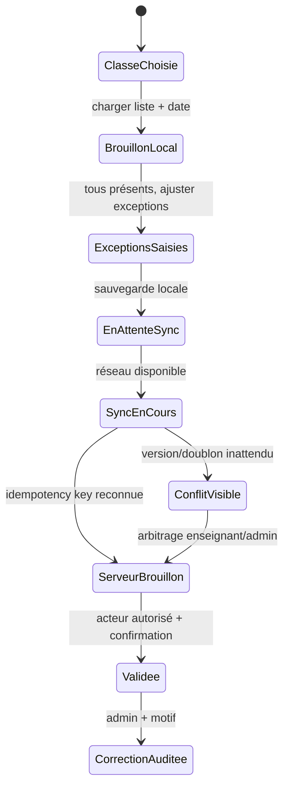

# Fiche IDEA-ENS-01 — Appel rapide et reprise hors-ligne

## Résumé en 10 lignes

1. La présence a déjà création de session, synchronisation et validation ; l’objectif est d’améliorer la vitesse et de tester les coupures.
2. L’enseignant appelle sa classe affectée, idéalement par « tous présents sauf… ».
3. Aucun appel n’est envoyé hors connexion sans état local clair.
4. Une validation ferme la session et trace l’auteur.
5. Les corrections après validation restent administratives et auditables.
6. L’affichage est conçu pour Android modeste, petit écran et faible bande passante.
7. Chaque synchro est idempotente et les conflits sont visibles, jamais perdus.
8. Les parents ne sont pas notifiés automatiquement par WhatsApp.
9. Aucune donnée de santé ou commentaire libre sensible n’est ajoutée au pointage.
10. Cibles : appel médian ≤30 secondes ; zéro perte sur suite de tests de coupure.

## 1. Problème, persona, KPI

Enseignant au premier cours, parfois réseau instable. Le code actuel expose déjà routes et service de présence (`routes/web.php:28-40`, `AttendanceService.php:59-107,146-164`). Avant build, mesurer la médiane par classe, le nombre de validations tardives et les corrections. Après : appel complet en ≤30 s, 0 perte après coupure simulée, ≥95 % sessions validées le jour même.

## 2. Périmètre

- **MVP** : liste de classe affectée, valeurs par défaut « présent » avec action globale explicite, marquer exceptions absent/retard/excusé, brouillon local, file de sync idempotente, bouton final « Valider ».
- **V2** : import des justificatifs par personnel habilité et retards fréquents selon règles validées.
- **Hors périmètre** : géolocalisation, biométrie, punition automatique, notification automatique à un tuteur non vérifié.

## 3. Workflow

Gardes : date/année de classe active, affectation enseignante, une session par classe/date/type. Si session déjà ouverte, reprendre; si validée, empêcher second appel. Local storage minimal et chiffré/isolé selon capacités du navigateur à évaluer; déconnexion du compte purge le cache local.

## 4. Modèle de données

Réutiliser `attendance_sessions`, `attendance_records` et les routes/service existants. Vérifier migrations et contraintes avant toute nouvelle table.

Compléments seulement si manquants : `client_mutation_id` unique par `school_id,session_id`; `version`/`updated_at`; `sync_status` séparé côté client et jamais autorité serveur ; `attendance_session_events` avec session, actor, event, version, motif. Index `(school_id,class_room_id,attendance_date)` et FK de tous les records à la session de la même école. Conserver les snapshots de statut et corrections d’audit.

## 5. ACL

| Action | Directeur | Censeur (rôle à créer/valider) | Enseignant | Comptable | Parent |
|---|---:|---:|---:|---:|---:|
| Voir appel | Toutes classes | Périmètre école | Affectations seulement | Non | Aucun MVP |
| Saisir/synchroniser | Selon délégation | Oui si affecté | Ses affectations | Non | Non |
| Valider/corriger | Oui, motif | Oui, motif | Valide sa session | Non | Non |
| Export présence | Selon besoin | Oui | Ses classes | Non | Aucun MVP |

## 6. UX

Écran « Mes cours aujourd’hui », 1 action pour ouvrir l’appel, puis une action par exception et validation. Cible 2–3 interactions pour une classe sans exception. Afficher le compteur présent/absent/retard/excusé et dernier sync. Message : « Appel enregistré sur cet appareil, en attente de réseau » ; « Une version existe déjà sur le serveur. Comparez avant de remplacer. » Pas d’animation lourde. Clavier/accessibilité : grand hit area, annonces accessibles, couleurs + libellés. Offline limité à ce flux, date du dernier sync visible.

## 7. Notifications

Au parent : pas de notification automatique MVP. Si un futur workflow approuvé crée un lien WhatsApp : « L’établissement {school_name} souhaite vous informer d’une absence de {student_first_name} le {attendance_date}. Contactez {school_phone}. » Pas d’état envoyé/livré, uniquement `link_generated`/`link_opened`. Email éventuel à personnel : session non synchronisée `{class_name}`, `{session_date}`, `{last_sync_at}` ; pas de coordonnées ni détails inutiles.

## 8. Règles et cas limites

Élève arrivé tard après validation : correction administrative avec motif, pas nouvel appel. Changement de classe : liste figée de la classe à la date de la session. Transfert : historique dans l’ancienne inscription, présence du jour selon classe effective. Année clôturée : lecture seule. Appareil partagé : déconnexion et purge locale. Deux appareils enseignant : version serveur gagne seulement après comparaison ; résolution humaine.

## 9. Conformité

Données d’identité d’élèves mineurs, classe et présence. Finalité assiduité/suivi scolaire. Durée de présence à fixer par l’école/juriste ; proposition initiale : année active + archive suivant politique de conservation validée. [À CONFIRMER] base légale, information responsable, durée, droits, hébergement et transfert. Minimiser les détails libres et ne pas profiler l’élève.

## 10. Intégrations et tests

Sync API déjà présente; aucune API payante. Tests service/race, perte réseau avant/après validation, retry double, déconnexion, téléphone partagé, ACL par classe, inter-écoles, 2 000 élèves + classes simultanées, E2E hors réseau simulé puis resync PostgreSQL.

## 11. Livraison

Observation et profiling existant 1–2 j ; amélioration UI 2–4 j ; idempotence/conflits si nécessaire 2–4 j ; tests mobiles/réseau/ACL 1–2 j. **Total 6–12 jours** selon niveau de robustesse déjà couvert. Risque : les tests actuels pourraient déjà suffire ; mesurer avant réécriture.
