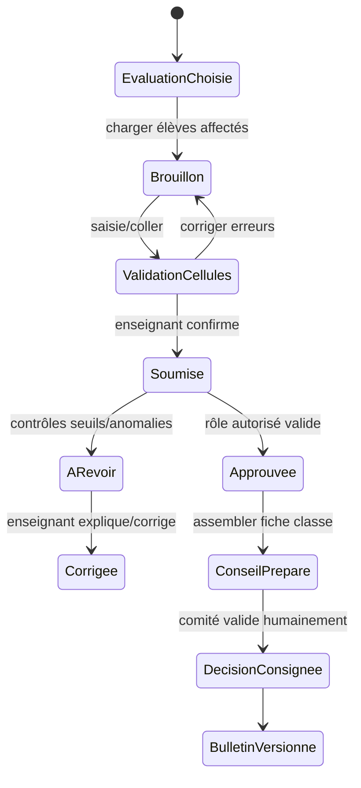

# Fiche IDEA-ENS-02 — Grille de notes et dossier de conseil

## Résumé en 10 lignes

1. Saisie de notes et import CSV existent ; le but est de réduire le temps de lot et les corrections.
2. L’enseignant ne voit que ses classes/matières affectées.
3. Le MVP propose un tableau clavier/coller, avec validation ligne par ligne.
4. Les règles d’évaluation sont d’abord celles configurées et versionnées ; pas de calcul caché.
5. Le censeur/direction obtient un dossier de conseil sans export officiel supposé.
6. Aucun rang ou décision n’est publié avant vérification humaine.
7. Les corrections tardives créent une nouvelle version/audit.
8. Le cache offline de notes est différé jusqu’au test de menace et de conflits.
9. Les formats MEPST/DRE restent ajustables, à confirmer.
10. Cibles : temps de saisie de 40 élèves réduit de 50 %, erreurs détectées avant validation ≥95 %.

## 1. Problème, persona, KPI

Enseignant pendant saisie de composition ; censeur pour préparer le conseil. Preuves de l’existant : `GradeEntry.php:34-43,57-79,103-123`, `GradeImport.php:45-88`, `ReportCardService.php:22-59,65-112`. Mesurer temps de 40 notes, erreurs de format, nombre de corrections après publication et temps de préparation de conseil. Aucun benchmark actuel disponible.

## 2. Périmètre

- **MVP** : grille notes par classe/matière/évaluation ; navigation clavier ; coller TSV ; erreurs visibles sans rejet silencieux ; sauvegarde brouillon ; dossier de conseil téléchargeable interne avec moyennes/absences/observations existantes.
- **V2** : commentaires déterministes éditables et export générique de candidats.
- **Hors périmètre** : OCR feuille, IA générative, classement public, décisions automatiques, format officiel non fourni.

## 3. Workflow

Une note hors barème est bloquée ou demande confirmation avec justification ; pas d’écrasement d’évaluation approuvée. Coupure : brouillon local non activé au MVP; si activé plus tard, mutation idempotente et conflit présenté.

## 4. Modèle de données

Réutiliser assessments/grades/appreciations/report-cards/report-card versions. Nouvelles tables seulement si absence : `grade_import_batches(school_id,assessment_id,actor_id,status,counts)` et `grade_import_rows(batch_id,row_number,result,error_code)` sans conserver la copie complète après traitement. Index `(school_id,assessment_id,student_id)` et unicité de la note pour l’évaluation/élève/matière conforme au modèle existant. Dossier conseil = vue/export construit à la demande; décisions finales dans un registre versionné, FK année/période/élève/classe.

## 5. ACL

| Action | Directeur | Censeur | Enseignant | Comptable | Parent |
|---|---:|---:|---:|---:|---:|
| Saisir/importer notes | Selon rôle | Selon délégation | Affectations seulement | Non | Non |
| Voir les notes | École | École | Classes affectées | Non | Aucun MVP |
| Approuver/publication | Oui | Selon rôle futur | Non | Non | Non |
| Décision de conseil | Validation humaine | Oui si rôle créé | Participer sans droit d’approbation seule | Non | Non |

## 6. UX

Sélecteur classe/matière/évaluation puis grille ; collage TSV avec aperçu ; badges erreurs et barre sauvegarde. Cible : 3 étapes, entrée clavier continue. Mobile lecture/correction ponctuelle, grille principale optimisée tablette/ordinateur ; pas de table de 40 colonnes. Erreurs : « 3 notes dépassent le barème de 20 ; elles n’ont pas été publiées. »; « Évaluation clôturée : demandez une réouverture à la direction. » Navigation clavier, lecteur d’écran et focus stable.

## 7. Notifications

Email interne censeur à échéance saisie dépassée seulement si configuration et règle décidées : `{teacher_name}`, `{class_name}`, `{assessment_name}`, `{due_date}`. WhatsApp vers parent non applicable tant que notes non publiées/portail reporté. Si Click-to-Chat ultérieur, modèle sans détails de notes et statut « lien préparé/ouvert » uniquement.

## 8. Règles et cas limites

Transfert : note liée à l’inscription et classe d’évaluation au moment du test. Absence : valeur absente distincte de zéro. Correction après clôture : demande motivée, nouvelle version et recalcul avec aperçu. Matière sans coefficient : bloquer publication jusqu’à règle confirmée. Conseil : procès-verbal et décisions n’entrent qu’après validation humaine. Examen officiel : export générique, colonnes paramétrables, aucun format prétendu officiel.

## 9. Conformité

Notes, appréciations, présence, décisions concernant mineurs. Accès enseignant strictement affectation; confidentialité et non-stigmatisation. Conservation de snapshots selon politique scolaire/juriste à valider ; [À CONFIRMER] exigences du ministère, droits d’accès/correction, transferts hébergement/email. Pas de données personnelles vers une IA externe.

## 10. Intégrations et tests

Réutiliser le calcul et workflow de bulletin existant ; export CSV/PDF interne. Tests barèmes, collage, arrondis, absence/zero, correction versionnée, ACL classe/matière, isolation tenant, 2 000 élèves et fin de trimestre concurrente, E2E saisie→conseil→approbation→bulletin.

## 11. Livraison

Observation 1–2 j ; grille et collage 3–5 j ; contrôles/états d’erreur 1–2 j ; dossier conseil compact 3–5 j ; tests 2–3 j. **Total 10–17 j**. Risque : règles diverses école par école ; isoler interface du moteur et reporter règle non confirmée.
