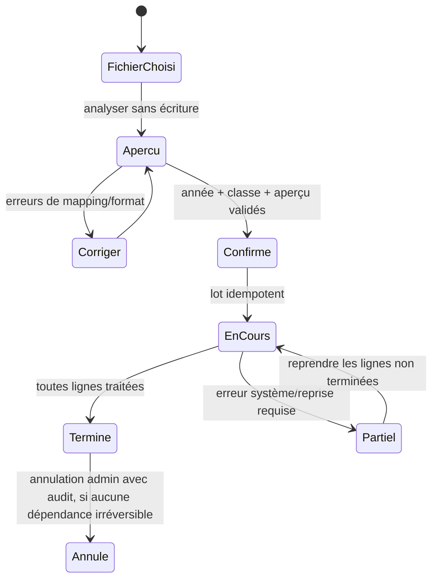

# Fiche IDEA-ONB-01 — Import guidé et activation

## Résumé en 10 lignes

1. Le CSV élèves existe par commande, mais l’import de référence n’associe pas la classe à une inscription via le CLI.
2. L’utilisateur MVP est la secrétaire, accompagnée au besoin par le directeur.
3. Le résultat visé est une première cohorte importée et inscrite en une journée sans commandes serveur.
4. Le MVP importe élèves, responsables et inscriptions pour une année/classe choisie.
5. Il ne fusionne pas automatiquement deux personnes sur la base du seul nom ou téléphone.
6. Chaque ligne reçoit un résultat lisible et un identifiant de lot idempotent.
7. Les imports ne sont jamais « réussis » si des lignes ont échoué ou ont été ignorées sans explication.
8. L’import exige une école et une année active explicites ; `school_id` est forcé côté serveur.
9. Aucun service payant ni traitement cloud de tableur n’est requis.
10. Cible pilote : 2 000 élèves, ≥98 % de lignes valides, ≤1 jour ouvré, zéro mauvais rattachement.

## 1. Problème, persona, valeur et KPI

- **Persona** : secrétaire lors de la rentrée ; directeur responsable de la bonne cohorte.
- **Problème** : import actuel par CLI, colonnes et cohérence des inscriptions difficiles à corriger pour un utilisateur non technique. Preuve : `app/Console/Commands/ImportStudentsCommand.php:8-21`, `StudentCsvImporter.php:97-105`.
- **Avant** : mesurer minutes de préparation, lignes corrigées, dossiers avec classe/année manquante.
- **Après cible** : 2 000 lignes importées ou expliquées en moins d’un jour ; ≥98 % des lignes valides créées ; doublons potentiels mis en revue, jamais fusionnés silencieusement.
- **Mesure in-app** : `import_batches.started_at/completed_at`, compteurs `created/updated/skipped/failed`, row errors, et échantillon de réconciliation signé par secrétaire.

## 2. Périmètre

- **MVP** : CSV UTF-8 ; mapping colonnes avec aperçu 20 lignes ; validation complète avant écriture ; sélection école/année/classe ; import atomique par ligne avec rapport ; reprise du lot idempotente ; modèle CSV téléchargeable.
- **V2** : XLSX si librairie déjà approuvée, détection de doublons assistée, import de réinscriptions et transfert de classe.
- **Hors périmètre** : extraction OCR/photo, fusion automatique d’identité, admission publique avec données de mineurs, import simultané de notes/finances.

## 3. Workflow et reprise

Garde : utilisateur autorisé à gérer élèves, tenant actif, année/classe du même `school_id`. Une coupure ne répète pas les lignes déjà créées : clé unique `(school_id, batch_id, row_number)` et transaction par ligne. Erreur CSV = arrêt avant écritures ; erreur ligne = résultat partiel explicite.

## 4. Modèle de données proposé

| Table | Champs clés / contraintes |
|---|---|
| `student_import_batches` (nouvelle) | `id`, `school_id`, `academic_year_id`, `created_by`, `file_name` (nom nettoyé), `file_sha256`, `status`, compteurs, dates, `mapping_json` minimisé ; index `(school_id,status,created_at)`. |
| `student_import_rows` (nouvelle) | `school_id`, `batch_id`, `row_number`, `result`, `student_id` nullable, `error_codes` structurés ; unique `(school_id,batch_id,row_number)`. Pas de copie durable de la ligne source entière. |
| `students/guardians/enrollments` (existantes) | vérifier FK et contraintes, créer l’inscription en transaction ; ne pas modifier la structure avant inspection de migration réelle. |

Tous les enregistrements nouveaux portent `school_id`; validation d’appartenance serveur, FK composées ou garde de service testée. Conserver le manifeste et les erreurs métier, non le fichier original par défaut. La migration de remise en cohérence de l’import existant doit être non destructive.

## 5. ACL

| Action | Directeur | Secrétaire (rôle à valider) | Comptable | Enseignant | Super admin |
|---|---:|---:|---:|---:|---:|
| Prévisualiser/importer élèves dans son école | Oui | Oui après rôle confirmé | Non | Non | Seulement en intervention justifiée |
| Voir les erreurs du lot | Oui | Oui | Non | Non | Selon intervention |
| Exporter le rapport | Oui | Oui | Non | Non | Selon intervention |
| Fusionner doublons / changer école | Validation humaine; pas de fusion MVP | Non | Non | Non | Non en usage courant |

## 6. UX

Parcours cible : « Élèves → Importer → Fichier → Associer colonnes/année/classe → Aperçu et erreurs → Confirmer » (**5–7 actions**, cible à valider). Mobile : lecture/validation possible, chargement de fichier et mapping optimisés desktop/tablette ; pas de dépendance à un tableur local. États vides : modèle CSV + exemple fictif. Messages : « 18 lignes nécessitent une correction. Aucune donnée n’a encore été importée. » ; « Import interrompu : 412 lignes traitées, 588 restent à reprendre. »

Accessibilité : libellés textuels, navigation clavier, erreurs près de la cellule, contraste AA. Offline : le fichier ne s’importe pas hors connexion ; brouillon du mapping peut rester local si navigateur autorisé, jamais les données d’élèves sans décision de sécurité.

## 7. Notifications

Pas de notification parent automatique MVP. Emails internes optionnels au créateur : `import terminé`, variables `{school_name}`, `{batch_id}`, `{created_count}`, `{failed_count}`, lien protégé. WhatsApp Click-to-Chat n’est pas utilisé. Aucun statut « import confirmé par le parent ».

## 8. Règles métier et cas limites

- Fratrie : préserver dossiers individuels ; rattacher à famille uniquement par identifiant confirmé, pas téléphone partagé.
- Transfert en cours d’année : créer l’inscription et historiser l’ancienne classe, sans écraser l’année précédente.
- Doublons : bloquer/placer en revue ; ne pas auto-fusionner nom/date de naissance.
- Lignes vides ou téléphone invalide : codes d’erreur français et téléchargeable.
- Année clôturée : refuser le lot ; action directeur explicite pour réouvrir selon politique d’école.
- Réimport : même hash/batch = rejouer idempotemment; nouveau fichier = demander la stratégie create/update.

## 9. Conformité

Données traitées : identifiants d’élèves, responsables, coordonnées et classe. Finalité : création/mise à jour de dossiers demandés par l’école. [À CONFIRMER avec juriste] rôle de l’école et du sous-traitant, information des responsables, base juridique, durées de conservation du lot, droits d’accès/rectification, sauvegardes et transferts hors Togo. Proposition de minimisation : supprimer le fichier temporaire après rapport et retenir seulement journal/résultats, durée proposée **90 jours** à faire valider. Ne pas ajouter santé ou données familiales sensibles.

## 10. Intégrations et tests

CSV natif gratuit, queues internes si nécessaires ; aucune API payante. Interface d’import isolée pour ajouter XLSX sans coupler la logique métier.

Tests : fichiers valides/invalides/UTF-8/accents ; 2 000 lignes ; idempotence coupure après 400e ligne ; conflits de doublon ; ACL par rôle ; import inter-écoles interdit ; test PostgreSQL, transactions, perf ; E2E secrétaire de fichier jusqu’à inscription et export d’erreurs.

## 11. Livraison, estimation, hypothèses et risques

1. Échantillons anonymisés, contrats CSV et règles : 1–2 j.
2. Aperçu/mapping/validation sans écriture : 2–4 j.
3. Lot idempotent + rapport et reprise : 3–5 j.
4. Tests ACL, charge, E2E et test pilote : 2–3 j.

**Total : 8–14 jours**. Hypothèse : modèles existants stables et pas d’upload XLSX MVP. Risque majeur : qualité hétérogène des fichiers ; parade : import de simulation avant engagement commercial.

## État de réalisation local

**État au 20 octobre 2026 : MVP CSV local implémenté; validation pilote non commencée.** Le flux est vérifié avec des fixtures exclusivement synthétiques. Le test de volume couvre l’analyse et la simulation de 2 000 lignes, pas l’écriture métier complète ni un environnement de production PostgreSQL/stockage privé. La checklist d’activation reste limitée aux cinq étapes existantes et propose la prochaine action; elle ne prétend pas mesurer l’opérationnalité complète de l’école.

Avant tout import réel : obtenir un fichier anonymisé autorisé, valider les règles et la réconciliation avec l’école, mesurer le parcours métier complet, puis faire confirmer la conservation et le traitement par un juriste/IPDCP. Le KPI pilote n’est pas atteint sur la base des seules fixtures. Ne pas commencer le pari suivant avant cette revue. Voir `docs/dev/onb-01-rapport-mesure.md`, `docs/dev/onb-01-decisions.md` et `docs/innovation/06-validation-terrain.md`.
