# Fiche IDEA-PED-01 — Règles pédagogiques versionnées

## Résumé en 10 lignes

1. Le modèle possède des `EvaluationRuleSet` et seuils ; la couverture par niveau et leur versionnement doivent être vérifiés.
2. Le directeur/censeur configure, l’enseignant applique, le directeur valide.
3. Règles : coefficient, barème, arrondi, moyenne et calcul explicites.
4. Toute publication référence un instantané de règles, pas la « règle courante » mutable.
5. L’application propose des décisions, ne prononce jamais passage, redoublement ou exclusion automatiquement.
6. Comparaison et explication accompagnent chaque résultat.
7. Les règles d’une école ne sont pas présentées comme format national.
8. Année clôturée est immuable sauf réouverture auditée.
9. Les écarts sont testés avec données synthétiques, puis validés par trois écoles.
10. Cible : 100 % bulletins reliés à une version et baisse de 80 % des corrections post-publication.

## 1. Problème, persona et KPI

Censeur/directeur gèrent différents barèmes, enseignants saisissent ; une erreur de règle peut affecter toute une classe. Les seuils/configurations existent dans le dépôt (`EvaluationRuleSet`, `MentionThresholdResource.php`), mais niveau de personnalisation effectif et version immuable restent [À CONFIRMER]. Mesurer corrections, écarts entre calcul tableur et app, temps de validation.

## 2. Périmètre

- **MVP** : version de règles par école/année/niveau ; aperçu de calcul sur jeu fictif ; explication du calcul ; activation avec date ; verrouillage après première publication ; approbation humaine.
- **V2** : propositions explicables de passage basées sur les critères validés localement, avec motifs et override.
- **Hors périmètre** : décision automatique; barème national inventé; sanction/exclusion algorithmique; modèle IA.

## 3. Workflow

```mermaid
stateDiagram-v2
  [*] --> Brouillon
  Brouillon --> Simulee: jeu d'exemples
  Simulee --> Corrigee: écart constaté
  Simulee --> Soumise: auteur confirme règle
  Soumise --> Approuvee: directeur/censeur habilité
  Soumise --> Rejetee: commentaire
  Approuvee --> Active: année/période ouverte
  Active --> Figee: publication bulletin
  Figee --> Reouverte: directeur + motif + audit
  Reouverte --> NouvelleVersion: correction; ne pas modifier snapshot antérieur
```

Garde : règles valides et compatibles matière/niveau; aucune activation sans aperçu; approbateur distinct configurable. Échec calcul : bulletin non publié, erreur explicite, version précédente reste active.

## 4. Modèle de données

| Table | Champs clés |
|---|---|
| `evaluation_rule_sets` existante (à inspecter) | garder si schéma compatible; ajouter version immuable, `school_id`, année, niveau, `status`, `effective_from`, `created_by/approved_by`. |
| `evaluation_rule_set_versions` nouvelle si besoin | JSON structuré validé ou lignes normalisées: coefficient, scale, rounding, formula; hash et auteur/date; unique `(school_id,year,version)`. |
| `report_card_versions` existante | relier `rule_version_id`, snapshot résultat et inputs calculés; snapshot audité. |

Indices école/année/statut, FK composites ou validation centralisée pour refuser cross-school. Pas d’évaluation libre par chaîne de formule exécutable ; règles DSL bornées et testées.

## 5. ACL

| Action | Directeur | Censeur | Enseignant | Comptable | Parent |
|---|---:|---:|---:|---:|---:|
| Créer/versionner règles | Oui | Oui si rôle confirmé | Non | Non | Non |
| Simuler | Oui | Oui | Consultation de classe fictive | Non | Non |
| Approuver/activer | Oui | Selon délégation | Non | Non | Non |
| Appliquer/saisir notes | Supervision | Supervision | Affectations | Non | Non |
| Lire bulletin publié | Oui | Oui | Classes autorisées | Non | Portail différé |

## 6. UX

Assistant 4 étapes : niveau/période, formule et coefficients, simulation, validation. Tableau de calcul accessible; 4–6 clics avant approbation. Mobile sert à vérifier, pas éditer les coefficients massivement. Erreur : « Le barème totalise 24, alors que l’évaluation est sur 20. Corrigez le barème avant activation. »; « Cette version a déjà servi à publier des bulletins. Créez une nouvelle version. » Fonction offline limitée à lecture du bulletin local non-nominatif; configuration nécessite connexion.

## 7. Notifications

Email interne uniquement lors de demande d’approbation, `{school_name}`, `{academic_year}`, `{level}`, `{rule_version}`, `{approval_url}`; pas de notification parent avant publication. WhatsApp Click-to-Chat non applicable pour règles. Si des notifications parent futur, statut de génération de lien distinct du statut de publication.

## 8. Règles et cas limites

Coefficients nuls, arrondis, bonus, absence, notes manquantes et transferts doivent être définis par école. Correction après publication : nouvelle version, recomputation visible, décision de republier par humain, version antérieure conservée. Année clôturée : gel par défaut. Changement de classe : règle de la classe rattachée à la période de l’évaluation. Pas de décision automatique de passage ; proposition avec critères et source de règle explicitement indiqués.

## 9. Conformité

Données scolaires de mineurs et décisions pouvant affecter leur parcours. Finalité calcul/validation pédagogique. Durée : snapshots selon politique d’archives de l’école et avis juridique. [À CONFIRMER] règles ministérielles actuelles, obligations de conservation, droits/recours, nécessité d’informer responsables. L’outil n’est pas décideur; l’école reste responsable de la validation humaine selon cadre à vérifier.

## 10. Intégrations et tests

Réutiliser calculateur et bulletin actuels, export générique configurable. Tests unitaires de formule, propriétés/arrondis, fixtures par niveau fournies par écoles, version de règle persistée, changement rétroactif refusé, ACL et tenant, charge fin de trimestre, E2E règle→simulation→approbation→bulletin versionné.

## 11. Livraison

Collecte règles réelles/anonymisées 2–4 j ; versionnement et service 4–7 j ; simulation/UI 3–5 j ; migration compatibilité et tests 3–4 j. **Total 12–20 j**. Risque : variété des règles ; ne pas généraliser sans périmètre d’un niveau et validations de 3 écoles.
