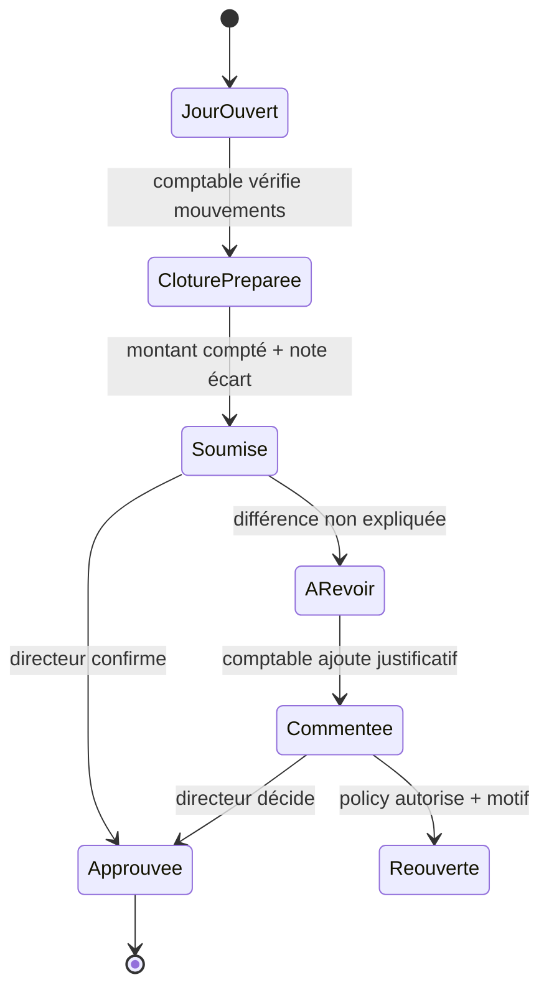

# Fiche IDEA-PIL-01 — Pilotage direction et clôture de caisse

## Résumé en 10 lignes

1. Le journal/clôture de caisse et des widgets existent, mais la vue direction consolidée n’est pas démontrée.
2. Le directeur voit un état horodaté de trésorerie, encaissements, soldes échus, présence et retard de saisie.
3. Le comptable soumet sa clôture quotidienne, puis le directeur traite les écarts.
4. Un écart est un fait à examiner, pas une accusation de fraude.
5. Chaque chiffre affiche sa période, source, dernière mise à jour et drill-down autorisé.
6. Les données financières s’appuient sur transactions existantes, jamais sur un total saisi manuellement.
7. Aucun KPI opaque ni comparaison publique entre écoles.
8. Dashboard mobile sobre, cache horodaté uniquement après protection locale validée.
9. Les pics à 2 000 élèves doivent être mesurés sous PostgreSQL, pas supposés.
10. Cible : état hebdomadaire <5 min, clôture quotidienne ≤10 min, 100 % écarts suivis.

## 1. Problème, valeur et mesure

Persona acheteur : directeur/fondateur ; exécutant : comptable. Baseline : durée pour agréger caisse, échéances et présence depuis les écrans existants. KPI in-app : temps d’ouverture/consultation (agrégé), temps entre clôture soumise/approuvée, écart en attente, fraîcheur par widget. Pas de suivi individuel de performance enseignant en MVP.

## 2. Périmètre

- **MVP** : cartes trésorerie de la journée, clôture attendue/soumise, écarts documentés, factures échues, présence du jour, statut publication bulletin ; lien vers source.
- **V2** : tendance mensuelle et comparaison à objectif interne, dépenses prévues vs approuvées.
- **Hors périmètre** : prévision statistique, score de risque personnel, paie, consolidation multi-campus, affichage d’informations nominatives par défaut.

## 3. Workflow

Gardes : journée/école/devise définies ; une clôture par caisse et date ; approbateur différent du soumetteur si séparation des tâches activée. Récupération : nouvelle soumission versionnée après incident, pas d’écrasement.

## 4. Données

Réutiliser `cash_closures`, `cash_opening_balances`, `payments`, `transactions`, `expenses` et leurs services existants (`CashJournalService.php`, `PaymentService.php`). Vérifier les schémas et ne pas ajouter de copie d’agrégats.

Tables proposées uniquement si absence prouvée : `cash_closure_events(school_id,closure_id,actor_id,event_type,amount_snapshot,reason,created_at)`; unique `(school_id,closure_id,version)`; index `(school_id,created_at)`. Dashboard en requêtes bornées par `school_id`, `academic_year_id`, date; éviter N+1, matérialisation avant profiling interdite.

## 5. ACL

| Action | Directeur | Comptable | Secrétaire | Enseignant | Super admin |
|---|---:|---:|---:|---:|---:|
| Voir synthèse | Oui | Oui (finance limitée) | Non | Oui présence personnelle seulement | intervention justifiée |
| Préparer/soumettre clôture | Non par défaut | Oui | Non | Non | Non |
| Approuver/réouvrir | Oui | Non | Non | Non | Non |
| Voir données nominatives drill-down | Selon rôle/purpose | Finance école | Élèves selon rôle | Classes affectées | intervention journalisée |

## 6. UX

Dashboard avec 4–6 cartes, filtre année/période, horodatage, états « données à jour / données retardées ». Cible 1–2 clics pour détail. Message : « Données financières actualisées à {date_heure}. »; « Clôture en attente de justification : aucun mouvement n’a été modifié. » Mobile, contraste, valeurs monétaires textuelles et export imprimable léger. Hors-ligne : montrer dernier état avec bandeau date ; pas de validation caisse offline.

## 7. Notifications

Email interne directeur à clôture soumise, `{school_name}`, `{cash_date}`, `{variance}`, `{closure_url}`; envoyer après commit et marquer queue/échec précisément. Click-to-Chat n’est pas adapté aux données de caisse sensibles. Aucun message parent dans le MVP.

## 8. Cas limites

Paiements partiels et remboursements affichés selon date transaction; annulation après clôture déclenche correction/écart, ne réécrit pas l’historique; caisse en devise? [À CONFIRMER] lancement FCFA; journée traverse minuit/fuseau; fermeture double empêchée; année clôturée consultable; dépenses en approbation exclues des dépenses payées.

## 9. Conformité

Données financières du personnel, familles et élèves via références de facture. Finalité pilotage et contrôle. Proposition de durée des snapshots : durée comptable définie par le professionnel compétent ; ne pas imposer de délai avant revue. [À CONFIRMER] conservation, droits d’accès, transferts mail/hosting, politiques d’audit; réduire l’affichage et les exports nominaux.

## 10. Intégrations et tests

Réutiliser finance existante ; EmailChannel interne ; aucun tiers payant. Tests de calcul de caisse, concurrence paiement/clôture, idempotence, refus inter-école, approbation séparée, date locale, 2 000 élèves / pic de clôture PostgreSQL, EXPLAIN requêtes et E2E comptable→directeur.

## 11. Livraison

Baseline et définitions KPI 1–2 j ; événements d’écart si besoin 1–3 j ; vues et dashboard 2–4 j ; tests de charge/ACL 2–3 j. **Total 5–9 j** pour un dashboard réutilisant l’existant, ou 8–14 j si le rapprochement/caisse est incomplet. Risque : chiffres incohérents entre méthodes de calcul; publier dictionnaire et source de chaque indicateur.
