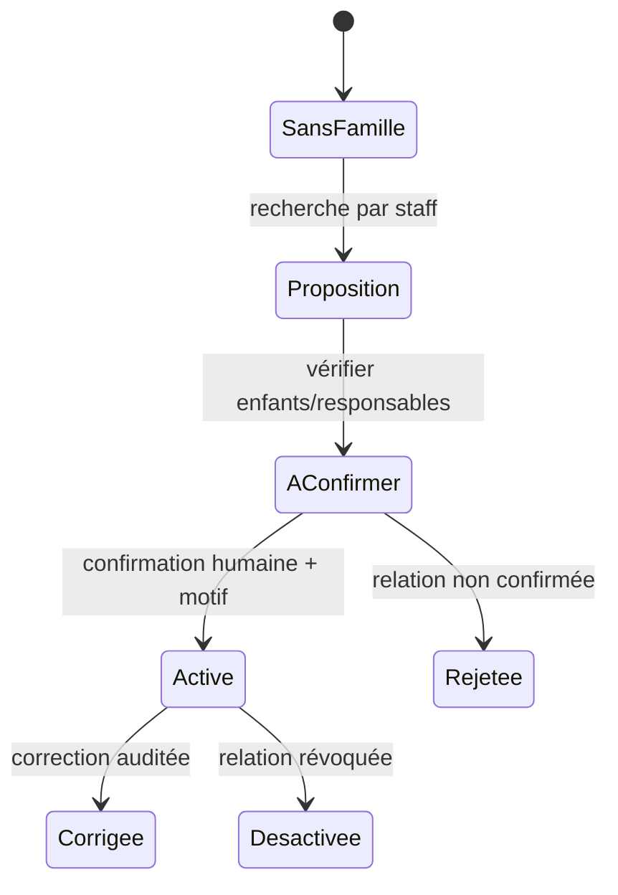

# Fiche IDEA-REC-01 — Famille, responsables et solde consolidé

## Résumé en 10 lignes

1. L’application possède des élèves et des responsables ; un compte famille consolidé n’est pas établi dans les preuves d’audit.
2. Le comptable est l’utilisateur MVP, pas le parent.
3. La vue présente ensemble les enfants d’un même foyer et conserve le détail du solde de chacun.
4. Le téléphone partagé n’est jamais la clé d’identité ni une autorisation suffisante.
5. L’école confirme explicitement la relation et peut la révoquer ou la corriger.
6. Une famille peut avoir plusieurs responsables et un responsable peut être lié à plusieurs élèves.
7. Les remises/exonérations restent des écritures autorisées, datées et motivées.
8. Le module ne crée pas de portail ni de connexion parent.
9. Scoping `school_id` obligatoire et tests d’isolation à chaque requête.
10. KPI cible : retrouver le solde consolidé en ≤30 s, sans fusion erronée.

## 1. Problème, persona, valeur et KPI

Persona : comptable/secrétaire au guichet, lors d’un appel de parent. Aujourd’hui une relance ou une recherche peut être enfant par enfant ; cette friction est [HYPOTHÈSE] à mesurer, car l’état complet de la relation n’a pas été confirmé dans le modèle examiné. KPI avant/après : durée pour répondre à « combien devons-nous pour les enfants de cette famille ? » ; taux de corrections de rattachement ; appels nécessitant reprise.

## 2. Périmètre

- **MVP** : fiche famille privée côté staff, plusieurs responsables/enfants, relation typée, vue de solde par enfant et total calculé à la demande, historique de rattachement et fusion administrative sous double confirmation.
- **V2** : partage de factures/échéanciers, autorisations parentales granulaire, portail après validation terrain.
- **Hors périmètre** : authentification parent, partage de données entre écoles, déduction d’un foyer à partir du nom/adresse/téléphone.

## 3. Workflow

Gardes : même école ; acteur autorisé ; une relation ne modifie pas les factures ni les droits parent. Échec réseau : aucune mutation non confirmée ; reprise par `idempotency_key`. Relations contradictoires restent en revue.

## 4. Modèle de données proposé

| Table | Champs / contraintes |
|---|---|
| `families` nouvelle | `id`, `school_id`, `display_name` non identifiant sensible, `status`, `created_by`; index `(school_id,status)`. |
| `family_guardians` nouvelle | `school_id`, `family_id`, `guardian_id`, `relationship_label`, `verified_at/by`, `valid_from/to`; unique relation active. |
| `family_students` nouvelle | `school_id`, `family_id`, `student_id`, `verified_at/by`, dates ; unique `(school_id,family_id,student_id)` ; contrôle d’appartenance. |
| `family_link_audits` nouvelle ou audit commun | avant/après, motif, acteur et date ; pas de copie de coordonnées inutile. |

Solde dérivé depuis factures, allocations, exonérations et annulations existantes ; ne pas maintenir une somme dénormalisée avant profilage. Ne pas ajouter une FK de famille « principale » à un élève sans migration rétrocompatible et règle de relation multiple.

## 5. ACL

| Action | Directeur | Comptable | Secrétaire (rôle à valider) | Enseignant | Parent |
|---|---:|---:|---:|---:|---:|
| Voir famille/solde | Oui | Oui | Oui selon rôle | Non par défaut | Aucun accès MVP |
| Ajouter/revoquer lien | Oui, motif | Oui, motif | Oui si mandaté | Non | Non |
| Modifier montant/remise | Selon policy finance | Selon seuil existant | Non | Non | Non |
| Exporter | Oui, audit | Oui si tâche | Non par défaut | Non | Aucun |

## 6. UX

Recherche depuis enfant ou responsable, puis fiche consolidée et détail par enfant ; 3–5 actions cible. Mobile : vue compacte avec noms et soldes, coordonnées masquées par défaut. État vide : « Aucun lien familial confirmé. Vérifiez avec le responsable avant d’associer. » Erreur : « Ce responsable appartient à une autre école. Aucune modification effectuée. » Accessibilité : distinction texte/couleur entre « confirmé » et « à confirmer ». Pas de cache parent/offline.

## 7. Notifications

Le module ne déclenche pas de contact. Modèle de lien WhatsApp seulement dans le module de recouvrement, avec prénom adulte si autorisé et récapitulatif non détaillé du montant ; `Lien de relance préparé` est l’état. Email interne possible `{family_id}`, pas de coordonnées dans les journaux. Aucun « envoyé » pour Click-to-Chat.

## 8. Règles métier et cas limites

- Tuteurs multiples : relation datée, droits/communication à confirmer avec école ; pas de présomption d’autorité.
- Téléphone partagé : plusieurs fiches peuvent partager un numéro, sans fusion.
- Fratrie recomposée : parent associé uniquement aux enfants confirmés, jamais à tous ceux d’un foyer supposé.
- Transfert : garder la relation historique et la facturation de l’école concernée.
- Décès/changement de garde : désactiver sans effacer l’historique ; accès fermé selon protocole validé.
- Année clôturée : soldes historiques en lecture seule.

## 9. Conformité

Identité mineur, responsable, relation familiale et données financières. Finalité : afficher les soldes aux personnels habilités. Proposition de conservation : lien actif pendant la relation scolaire, journal de correction selon durée comptable validée. [À CONFIRMER juriste/IPDCP] droits d’accès, statut des responsables, durée financière, information des personnes, transfert/hébergement. Ne pas exposer le total consolidé dans un message WhatsApp partagé.

## 10. Intégrations, tests

Réutilise les responsables, élèves et services finance ; aucun service tiers. Interface interne `FamilyBalanceReader` laisse le portail futur découplé.

Tests : relation un-à-plusieurs et plusieurs-à-plusieurs ; recalcul après paiement partiel/annulation ; interdiction inter-école ; directeur/comptable/enseignant ; collision de téléphone non fusionnée ; changement d’année/transfert ; charge requêtes avec 2 000 élèves/1 000 familles ; E2E ajout, validation, correction et audit.

## 11. Livraison et estimation

Découverte du schéma existant 1–2 j ; migrations/services 3–5 j ; recherche/vue et UX 2–4 j ; ACL/tests/audit 2–3 j. **Total 8–14 jours**. Risque : les écoles ne partagent pas la même définition de « famille/débiteur » ; valider le vocabulaire et droits avant migration.
