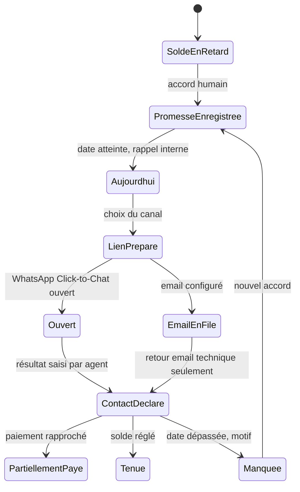

# Fiche IDEA-REC-02 — Promesses et suivi de recouvrement

## Résumé en 10 lignes

1. Des relances programmées existent, mais la promesse de paiement et son issue ne sont pas prouvées comme objets métier.
2. Le comptable traite chaque matin les promesses et échéances à venir.
3. Un rappel interne à date est gratuit et ne prétend pas envoyer un message.
4. WhatsApp reste un lien `wa.me` à cliquer par un humain ; email dépend de la configuration.
5. Un statut distingue « préparé », « lien ouvert », « contact déclaré » et « paiement rapproché ».
6. Les montants et remises restent soumis aux ACL financières existantes.
7. Chaque changement a un auteur, une date et un motif.
8. Les paiements partiels actualisent le reste dû via le service finance existant.
9. Une panne de queue ne perd pas une promesse ; traitement idempotent.
10. KPI cible : promesses échues sans suivi −50 % et deux fois plus de familles suivies par heure.

## 1. Problème, persona, valeur, KPI

Persona : comptable/économe ; directeur arbitre les exceptions. La planification des relances existe (preuves `ScheduleCollectionRemindersCommand.php` et `CollectionCenter.php`), mais l’objet « promesse tenue/manquée » reste à confirmer. Mesurer baseline : minutes de relance, promesses orales, part des comptes à J+30 et paiement après contact.

## 2. Périmètre

- **MVP** : enregistrer promesse (montant/date/motif/canal préféré), liste quotidienne, relance graduée configurée par école, journal de contact, lien WhatsApp ou email.
- **V2** : famille consolidée, segmentation, export de suivi et prévision prudente.
- **Hors périmètre** : envoi WhatsApp automatisé, SMS API, scoring opaque, pénalité automatique ou refus d’accès scolaire.

## 3. Workflow

`Ouvert` n’affirme pas qu’un message a été lu/livré. Rappels internes sont idempotents par promesse/date/canal. Échec email : statut échec + relance manuelle ; ne pas basculer silencieusement vers un autre canal.

## 4. Modèle de données proposé

| Table | Champs et invariants |
|---|---|
| `payment_promises` nouvelle | `school_id`, `family_id` nullable / `student_id`, `enrollment_id`, `created_by`, montant, devise, `due_on`, `status`, motif/code, `created_at`, `supersedes_id`; index `(school_id,status,due_on)`. |
| `collection_contact_events` nouvelle ou enrichissement de `collection_reminders` | `school_id`, promesse/facture, `actor_id`, channel, `event_type`, `occurred_at`, `idempotency_key`, modèle de message ID, hash de contexte minimal. |
| `notification_templates` (si existante, à réutiliser) | Identifiant stable, langue fr, version, variables autorisées, actif par école. |

Promesse non égale à facture ; solde calculé via `PaymentService`, aucune modification directe de transaction. Unique idempotency key. FK sur l’école, index dû/état, audit des montants/date.

## 5. ACL

| Action | Directeur | Comptable | Secrétaire | Enseignant | Parent |
|---|---:|---:|---:|---:|---:|
| Voir file et solde | Oui | Oui | Selon permission de recouvrement | Non | Aucun MVP |
| Créer/modifier promesse | Oui | Oui | Selon délégation | Non | Pas en self-service |
| Enregistrer contact | Oui | Oui | Oui si habilité | Non | Aucun |
| Modifier facture/paiement | Policy finance | Policy finance | Non | Non | Non |
| Voir journal complet | Oui | Oui | Limité à l’action | Non | Non |

## 6. UX

File du jour, filtres « aujourd’hui/en retard/échéance », fiche famille/élève, action lien/contact, saisie résultat ; 4–6 actions par cas. Mobile priorité au grand bouton « Ouvrir WhatsApp » et « Noter le résultat ». Messages en français : « Lien WhatsApp ouvert dans une nouvelle fenêtre. Scolaris ne peut pas confirmer l’envoi. »; « Rappel interne en attente : vérifiez votre connexion. » Pas d’envoi offline, promesse brouillon locale non persistée par défaut. Couleurs accompagnées de libellés.

## 7. Modèles de notification

- **WhatsApp Click-to-Chat** : « Bonjour {guardian_first_name}, l’établissement {school_name} vous contacte au sujet de la situation de frais de {student_first_name}. Merci de joindre le secrétariat au {school_phone} afin de confirmer le solde et l’échéance. » Le montant est omis par défaut sur téléphone partagé ; texte modifiable avant ouverture. Journal : `link_generated`, puis `link_opened` si retour possible.
- **Email** : objet « Situation de frais — {school_name} » ; corps : « Bonjour {guardian_first_name}, selon les informations enregistrées par l’école au {as_of_date}, le solde restant de {student_first_name} est de {balance_due} FCFA, échéance {due_date}. Pour toute correction, contactez {school_contact}. » Ajouter une voie de correction et ne pas affirmer un envoi si la queue est seulement en attente.

## 8. Règles et cas limites

Fratrie : contact sur le bon enfant; vue famille disponible avant regroupement. Paiement partiel : promesse diminue le solde seulement après paiement confirmé. Paiement non affecté : état « à rapprocher ». Deux promesses en concurrence : une active par facture/date ou relation de remplacement explicite. Échéance reportée : motif et ancienne date conservés. Année clôturée : historique en lecture seule. Téléphone partagé : pas de contenu montant nominatif dans le lien par défaut.

## 9. Conformité

Données mineur, responsable, dette scolaire, événement de contact. Finalité de gestion du règlement et preuve interne. Durée proposée : promesses actives + 24 mois après clôture, à valider avec comptable/juriste. [À CONFIRMER] base de contact par canal, information, droits, rétention comptable, sous-traitance email/hosting et transfert international. L’école doit définir politique de relance non coercitive. Ne pas inférer difficulté financière ou sanctionner automatiquement.

## 10. Intégrations et tests

Canaux existants : email configuré, lien WhatsApp gratuit. Abstraction `NotificationChannel` prévue pour APIs ultérieures ; contrat de sortie `link_generated/opened`, ne pas faire croire que le provider a livré. Tests : échéance, fuseau local, idempotence scheduler, email non configuré, WhatsApp partagé, paiement partiel, annulation, année clôturée, ACL/tenant, charge 10k promesses et E2E comptable.

## 11. Livraison et estimation

Règles métier avec 2 écoles 1–2 j ; modèle/états 2–3 j ; vue quotidienne et liens 2–3 j ; tests scheduler/finance/isolation 1–2 j. **Total 6–10 j**, hors dépendance vue famille si nécessaire (ajouter 8–14 j, ne pas coder les deux sans tests terrain). Risque : promesse orale sans accord clair ; conserver saisie par le personnel et permettre correction auditée.
